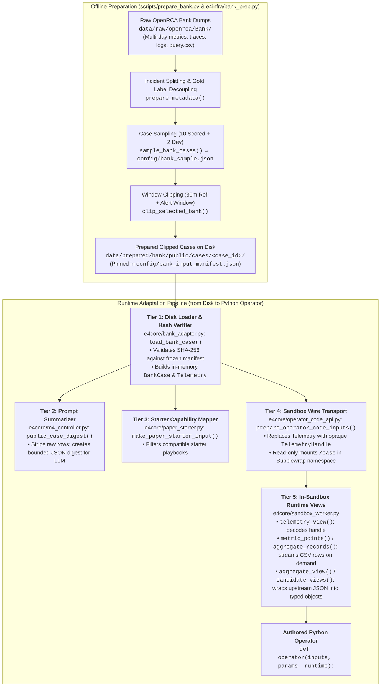

# Reading the E4 Implementation: Architecture, Data Flow & Code Execution Guide

This guide is an end-to-end technical reference for reading, debugging, and reviewing the E4 codebase. It details **where input data originates**, **how runs are launched**, and **the exact Python files and functions executed at every stage** of an incident diagnosis.

> [!NOTE]
> **Branch Context (November 2026):**
> The `paper-operator-code` branch evolves diagnoses by authoring typed Python functions over sandboxed data-acquisition APIs (authoring profile: `typed-operator-code-v1`). Legacy `typed-operator-ir-v1` and `v2` branches used constrained kernel DSLs; `typed-operator-code-v1` instead executes genuine, isolated Python code inside Bubblewrap (`bwrap`) containers.

---

## 1. Where Does Data Enter? (Data Origin, Preparation & Entry Points)

When you run an incident through E4, data does not simply appear in the case folder—it passes through an **offline preparation pipeline** from raw benchmark dumps, followed by a **5-tier runtime adaptation architecture** that safely connects disk files to the sandboxed Python operators.



### 1.1 Raw Benchmark Origin vs. Prepared Incident Data

The benchmark does not originate directly in `data/prepared/bank/public/cases/`. It was extracted and clipped from the **OpenRCA Bank benchmark** through an offline preparation pipeline:

1. **Raw Origin (`data/raw/openrca/Bank/`)**:
   Contains multi-day raw CSV telemetry files (container metrics, service metrics, jaeger spans, service logs) along with incident description sheets (`query.csv` and `record.csv`).
2. **Metadata Alignment & Ground Truth Decoupling** ([`prepare_metadata()`](file:///localscratch/ssinha97/E4/e4infra/bank_prep.py#L121) in [`e4infra/bank_prep.py`](file:///localscratch/ssinha97/E4/e4infra/bank_prep.py)):
   - Aligns all local China Standard Time timestamps to UTC epoch milliseconds.
   - Decouples private root-cause labels into `data/prepared/bank/evaluator/candidate_ground_truth.jsonl` (accessible only by the host evaluator) while saving public incident metadata to `candidate_incidents.jsonl`.
3. **Deterministic Sampling** ([`sample_bank_cases()`](file:///localscratch/ssinha97/E4/e4infra/bank_prep.py#L417) via [`scripts/prepare_bank.py`](file:///localscratch/ssinha97/E4/scripts/prepare_bank.py)):
   - Freezes the benchmark split into 10 scored cases and 2 disjoint development cases, recorded in [`config/bank_sample.json`](file:///localscratch/ssinha97/E4/config/bank_sample.json).
4. **Window Clipping** ([`clip_selected_bank()`](file:///localscratch/ssinha97/E4/e4infra/bank_prep.py#L865)):
   - Slices the massive multi-gigabyte raw tables down to only the **30-minute reference window** (normal baseline) and the **alert window** (incident period) for each case.
   - Writes the clipped tables into `data/prepared/bank/public/cases/<case_id>/`:
     - `metric_container.csv`, `metric_service.csv` (KPI time series).
     - `trace_jaeger.parquet` or `trace_service.csv` (RPC spans and call trees).
     - `log_service.csv` (window-clipped, hash-verified log events).
5. **Cryptographic Manifest Pinning**:
   - SHA-256 digests for all clipped tables and manifests are locked into [`config/bank_input_manifest.json`](file:///localscratch/ssinha97/E4/config/bank_input_manifest.json). Runtime loaders fail closed if any file is modified.

### 1.2 The Multi-Tier Runtime Data Adaptation Architecture

`load_bank_case` is **not the only code that adapts data**. It is simply Tier 1 of five distinct adaptation layers:

| Tier | Python File & Function | Adaptation Role |
| :--- | :--- | :--- |
| **Tier 1: Disk Loader** | [`load_bank_case()`](file:///localscratch/ssinha97/E4/e4core/bank_adapter.py#L310) in `bank_adapter.py` | Reads disk files, validates SHA-256 digests against [`config/bank_input_manifest.json`](file:///localscratch/ssinha97/E4/config/bank_input_manifest.json), and instantiates in-memory contracts: [`BankCase`](file:///localscratch/ssinha97/E4/e4core/bank_adapter.py#L63) and [`Telemetry`](file:///localscratch/ssinha97/E4/e4core/contracts.py#L96). |
| **Tier 2: Prompt Summarizer** | [`public_case_digest()`](file:///localscratch/ssinha97/E4/e4core/m4_controller.py#L1412) in `m4_controller.py` | Strips raw rows to produce a compact JSON digest (available metrics, time bounds, entity IDs) for the LLM prompt without exceeding token limits or leaking labels. |
| **Tier 3: Capability Mapper** | [`make_paper_starter_input()`](file:///localscratch/ssinha97/E4/e4core/paper_starter.py#L484) in `paper_starter.py` | Identifies which tables are present for this specific incident (e.g. container vs. traces) to filter compatible playbooks. |
| **Tier 4: Sandbox Staging** | [`prepare_operator_code_inputs()`](file:///localscratch/ssinha97/E4/e4core/operator_code_api.py#L342) in `operator_code_api.py` | Prepares inputs for Bubblewrap isolation: replaces `Telemetry` with an opaque `TelemetryHandle`, serializes other DAG inputs to wire JSON, and mounts `/case` read-only. |
| **Tier 5: Runtime View Helpers** | Data helpers in [`sandbox_worker.py`](file:///localscratch/ssinha97/E4/e4core/sandbox_worker.py) | Inside the container, [`telemetry_view()`](file:///localscratch/ssinha97/E4/e4core/sandbox_worker.py#L458) decodes handles, while [`metric_points()`](file:///localscratch/ssinha97/E4/e4core/sandbox_worker.py#L559) and [`aggregate_records()`](file:///localscratch/ssinha97/E4/e4core/sandbox_worker.py#L682) stream and aggregate rows on the fly. [`aggregate_view()`](file:///localscratch/ssinha97/E4/e4core/sandbox_worker.py#L863) and [`candidate_views()`](file:///localscratch/ssinha97/E4/e4core/sandbox_worker.py#L868) wrap upstream JSON into typed objects. |

### 1.3 The CLI Entry Points
To launch an evaluation or diagnostic run from your terminal:

1. **Single Incident Supervisor:**
   [scripts/run_m4_bank.py](file:///localscratch/ssinha97/E4/scripts/run_m4_bank.py)
   ```bash
   python -m scripts.run_m4_bank \
       --mode diagnostic \
       --case-id <INCIDENT_ID> \
       --library-root library/ \
       --run-dir runs/<RUN_ID> \
       --profile config/gemma_m3_inference.json
   ```
   - [`_run_outer()`](file:///localscratch/ssinha97/E4/scripts/run_m4_bank.py#L606) sets up a restricted, read-only project view (`create_restricted_project_view`) and launches Bubblewrap.
   - Inside the container, [`_run_inner()`](file:///localscratch/ssinha97/E4/scripts/run_m4_bank.py#L584) binds IPC feedback and calls [`run_diagnostic`](file:///localscratch/ssinha97/E4/e4core/m4_controller.py#L3393).

2. **Full Benchmark Shard Audit:**
   [scripts/run_paper_starter_audit.py](file:///localscratch/ssinha97/E4/scripts/run_paper_starter_audit.py)
   - [`_run_case()`](file:///localscratch/ssinha97/E4/scripts/run_paper_starter_audit.py#L422) reads the split manifest, instantiates [`EvaluationSession`](file:///localscratch/ssinha97/E4/e4core/m5_evaluation.py#L162) with private ground truth, and invokes the worker container for that case.

### 1.4 The Core Python Programmatic Entry Point
If you are reading or executing the diagnostic pipeline directly in Python, start at:
- **Function**: [`run_diagnostic`](file:///localscratch/ssinha97/E4/e4core/m4_controller.py#L3393) in [e4core/m4_controller.py](file:///localscratch/ssinha97/E4/e4core/m4_controller.py).

```python
from pathlib import Path
from e4core.m4_controller import run_diagnostic

result = run_diagnostic(
    case_id="2021_03_05_001",
    library_root=Path("config/paper_seed_library"),
    run_dir=Path("runs/my_diagnostic_run"),
    feedback=feedback_proxy,            # Socket or evaluator returning {"accepted": bool}
    profile_path=Path("config/gemma_m3_inference.json"),
    split="dev",                         # "dev" or "scored"
    root=Path(".")
)
```

Inside [`run_diagnostic`](file:///localscratch/ssinha97/E4/e4core/m4_controller.py#L3393):
1. **Loads Case (Tier 1)**: Calls [`load_bank_case(case_id, split, root=root)`](file:///localscratch/ssinha97/E4/e4core/bank_adapter.py#L310) in [e4core/bank_adapter.py](file:///localscratch/ssinha97/E4/e4core/bank_adapter.py).
2. **Builds Public Digest (Tier 2)**: Calls [`public_case_digest(case)`](file:///localscratch/ssinha97/E4/e4core/m4_controller.py#L1412) to create sanitized, non-label-leaking summaries for LLM prompts.
3. **Copies Library**: Clones `library_root` to `run_dir / "library"` and verifies integrity via [`snapshot_library`](file:///localscratch/ssinha97/E4/e4core/m4_library.py#L181).
4. **Constructs Operator Registry (Tier 3)**: Calls [`make_paper_starter_registry`](file:///localscratch/ssinha97/E4/e4core/paper_starter.py#L504) to load standard operators (`bank.metrics.aggregate`, etc.).
5. **Enters the 3-Stage Diagnostic Loop**: Iterates through `select` (Stage 1), `compose` (Stage 2), and `synthesize` (Stage 3).

---

## 2. End-to-End Execution Flow (Annotated Architecture Diagram)

The following Mermaid diagram maps every single step in an incident diagnosis to its **specific Python source file and function**:

```mermaid
flowchart TD
    classDef fileNode fill:#f8f9fa,stroke:#343a40,stroke-width:1.5px,color:#212529,text-align:left;
    classDef decisionNode fill:#e3f2fd,stroke:#1565c0,stroke-width:2px,color:#0d47a1,text-align:center;
    classDef termNode fill:#e8f5e9,stroke:#2e7d32,stroke-width:2px,color:#1b5e20,text-align:center;

    subgraph INGEST ["0. Ingestion & Environment Setup"]
        A["<b>Load Incident Case & Telemetry</b><br>• e4core/bank_adapter.py: <code>load_bank_case()</code><br>• e4core/m4_controller.py: <code>public_case_digest()</code>"]:::fileNode
        B["<b>Load Library Snapshot & Registry</b><br>• e4core/m4_library.py: <code>snapshot_library()</code><br>• e4core/paper_starter.py: <code>make_paper_starter_registry()</code>"]:::fileNode
        A --> C
        B --> C
        C["<b>Controller Main Entry</b><br>• e4core/m4_controller.py: <code>run_diagnostic()</code>"]:::fileNode
    end

    subgraph STAGE1 ["Stage 1: Playbook Retrieval (select)"]
        C --> S1_PROMPT["<b>Assemble Prompt & Query Model</b><br>• e4core/m4_controller.py: <code>_stage_prompt('select')</code><br>• e4core/m4_controller.py: <code>M4ModelClient.complete_for_stage()</code>"]:::fileNode
        S1_PROMPT --> S1_PARSE["<b>Parse Selection & Build Candidate DAG</b><br>• e4core/m4_controller.py: <code>_stage1_doc()</code><br>• e4core/m4_controller.py: <code>_apply_stage1_selection()</code>"]:::fileNode
        S1_PARSE --> S1_EXEC["<b>Verify & Execute DAG Pipeline</b><br>• e4core/dag.py: <code>verify_dag()</code><br>• e4core/executor.py: <code>SerialExecutor.execute_verified()</code>"]:::fileNode
        S1_EXEC --> S1_EVAL{"<b>Trusted Top-3 Feedback</b><br>• e4core/m4_controller.py: <code>_call_feedback()</code><br>• e4core/m5_evaluation.py: <code>EvaluationSession.submit()</code>"}:::decisionNode
    end

    S1_EVAL -->|accepted: true| RECORD["<b>Record Outcome & Invocations</b><br>• e4core/m4_library.py: <code>record_library_invocation()</code><br>• Output: <code>diagnostic_result.json</code>"]:::termNode
    S1_EVAL -->|accepted: false| STAGE2

    subgraph STAGE2 ["Stage 2: DAG Composition & Adaptation (compose)"]
        S2_PROMPT["<b>Format Adaptation Prompt (with History)</b><br>• e4core/m4_controller.py: <code>_stage_prompt('compose')</code><br>• e4core/m4_controller.py: <code>M4ModelClient.complete_for_stage()</code>"]:::fileNode
        S2_PROMPT --> S2_PARSE["<b>Validate Adaptation Record & New DAG</b><br>• e4core/m4_controller.py: <code>_validate_paper_adaptation_record()</code><br>• e4core/dag.py: <code>verify_dag()</code>"]:::fileNode
        S2_PARSE --> S2_CAP["<b>Check Table & Column Capabilities</b><br>• e4core/m4_capabilities.py: <code>check_typed_input_capabilities()</code>"]:::fileNode
        S2_CAP --> S2_EXEC["<b>Execute Composed Pipeline</b><br>• e4core/executor.py: <code>SerialExecutor.execute_verified()</code>"]:::fileNode
        S2_EXEC --> S2_EVAL{"<b>Trusted Top-3 Feedback</b><br>• e4core/m4_controller.py: <code>_call_feedback()</code><br>• e4core/m5_evaluation.py: <code>EvaluationSession.submit()</code>"}:::decisionNode
    end

    S2_EVAL -->|accepted: true| RECORD
    S2_EVAL -->|accepted: false| STAGE3

    subgraph STAGE3 ["Stage 3: Synthesis & Evolution (synthesize)"]
        subgraph S3A ["Phase 3A: EVOLVE (Authoring New Python Operators)"]
            S3_PROMPT["<b>Request Gap Record & Operator Code</b><br>• e4core/m4_controller.py: <code>_stage_prompt('evolve')</code><br>• e4core/m4_controller.py: <code>M4ModelClient.complete_for_stage()</code>"]:::fileNode
            S3_PROMPT --> S3_PARSE["<b>Parse Specs & Check Forbidden Literals</b><br>• e4core/m4_controller.py: <code>_candidate_spec_mapping()</code><br>• e4core/m4_controller.py: <code>reject_identifier_literals()</code><br>• e4core/m4_generated.py: <code>validate_generated_spec()</code>"]:::fileNode
            S3_PARSE --> S3_STATIC["<b>AST Safety Analysis</b><br>• e4core/sandbox_worker.py: <code>validate_source()</code>"]:::fileNode
            S3_STATIC --> S3_TYPE["<b>Strict Mypy Typecheck</b><br>• e4core/m4_typecheck.py: <code>check_generated_spec_types()</code>"]:::fileNode
            S3_TYPE --> S3_REG["<b>Register Validated Operator Specs</b><br>• e4core/m4_capabilities.py: <code>validate_input_requirements()</code><br>• e4core/m4_generated.py: <code>register_generated_specs()</code>"]:::fileNode
        end

        subgraph S3B ["Phase 3B: SERVE (Pipeline Construction & Sandbox Run)"]
            S3_REG --> S3B_PROMPT["<b>Request Serving DAG</b><br>• e4core/m4_controller.py: <code>_stage_prompt('stage3_serve')</code><br>• e4core/m4_controller.py: <code>M4ModelClient.complete_for_stage()</code>"]:::fileNode
            S3B_PROMPT --> S3B_VAL["<b>Resolve Generated Versions & Verify DAG</b><br>• e4core/m4_controller.py: <code>_resolve_generated_versions()</code><br>• e4core/dag.py: <code>verify_dag()</code><br>• e4core/m4_capabilities.py: <code>check_typed_input_capabilities()</code>"]:::fileNode
            S3B_VAL --> S3B_SANDBOX["<b>Execute Operators in Bubblewrap Sandbox</b><br>• e4core/executor.py: <code>SerialExecutor.execute_verified()</code><br>• e4core/operator_code_api.py: <code>prepare_operator_code_inputs()</code><br>• e4core/sandbox.py: <code>run_generated_operator()</code><br>• e4core/sandbox_worker.py: <code>main()</code> / <code>operator()</code>"]:::fileNode
        end

        S3B_SANDBOX --> S3_EVAL{"<b>Trusted Top-3 Feedback</b><br>• e4core/m4_controller.py: <code>_call_feedback()</code><br>• e4core/m5_evaluation.py: <code>EvaluationSession.submit()</code>"}:::decisionNode
    end

    S3_EVAL -->|accepted: true| ADMIT["<b>Admit New Operators & Playbook</b><br>• e4core/m4_library.py: <code>admit_after_accepted()</code>"]:::fileNode
    ADMIT --> RECORD
    S3_EVAL -->|accepted: false| RECORD
```



---

## 3. Stage-by-Stage Code Walkthrough (Where to Look in the Code)

This section provides the exact execution sequence, inputs, outputs, and specific source code locations for each stage in [`e4core/m4_controller.py`](file:///localscratch/ssinha97/E4/e4core/m4_controller.py).

The controller manages a stage loop defined at [Line 3557](file:///localscratch/ssinha97/E4/e4core/m4_controller.py#L3557):
```python
for stage in ["select", "compose", "synthesize"]:
```
At each iteration, it sets `serving_phase = "stage3_serve" if stage == "synthesize" else stage` ([Line 3735](file:///localscratch/ssinha97/E4/e4core/m4_controller.py#L3735)), routing to the stage-specific system prompt via [`system_prompt_for_stage()`](file:///localscratch/ssinha97/E4/e4core/m4_controller.py#L157).

---

### Stage 0: Case Ingestion and Registry Setup
* **Files**: [e4core/bank_adapter.py](file:///localscratch/ssinha97/E4/e4core/bank_adapter.py), [e4core/paper_starter.py](file:///localscratch/ssinha97/E4/e4core/paper_starter.py), [e4core/m4_library.py](file:///localscratch/ssinha97/E4/e4core/m4_library.py)

| Action | Exact Code Location | Description |
| :--- | :--- | :--- |
| **Verify Allowlist** | [Line 3431 in `m4_controller.py`](file:///localscratch/ssinha97/E4/e4core/m4_controller.py#L3431) | Ensures `case_id` is in [`config/bank_sample.json`](file:///localscratch/ssinha97/E4/config/bank_sample.json). |
| **Load Case Data** | [`load_bank_case()`](file:///localscratch/ssinha97/E4/e4core/bank_adapter.py#L310) (called at [L3433](file:///localscratch/ssinha97/E4/e4core/m4_controller.py#L3433)) | Validates hash manifests in `data/prepared/bank/`, parses timestamps, and builds [`BankCase`](file:///localscratch/ssinha97/E4/e4core/bank_adapter.py#L63). |
| **Public Digest** | [`public_case_digest()`](file:///localscratch/ssinha97/E4/e4core/m4_controller.py#L1412) (called at [L3434](file:///localscratch/ssinha97/E4/e4core/m4_controller.py#L3434)) | Extracts metric ranges, entity IDs, and alerts into a public JSON summary. |
| **Clone Library** | [`snapshot_library()`](file:///localscratch/ssinha97/E4/e4core/m4_library.py#L181) (called at [L3436](file:///localscratch/ssinha97/E4/e4core/m4_controller.py#L3436)) | Loads snapshot of previously admitted playbooks and operators into `run_dir / "library"`. |
| **Build Registry** | [`make_paper_starter_registry()`](file:///localscratch/ssinha97/E4/e4core/paper_starter.py#L504) (called at [L3456](file:///localscratch/ssinha97/E4/e4core/m4_controller.py#L3456)) | Registers baseline operators (`bank.metrics.aggregate`, `bank.trace.span_aggregate`, etc.). |

---

### Stage 1: Playbook Retrieval (`select`)
**Objective**: Ask the model to select an existing verified playbook from the library and supply runtime bindings without changing the graph structure.

| Step | Exact Code Location | Description |
| :--- | :--- | :--- |
| **Prompt Assembly** | [`_stage_prompt('select', ...)`](file:///localscratch/ssinha97/E4/e4core/m4_controller.py#L1885) | Formats candidate playbooks and alert summary into JSON prompt. |
| **Model Call** | [`model.complete_for_stage('select', ...)`](file:///localscratch/ssinha97/E4/e4core/m4_controller.py#L3781) | Queries local LLM; routes to Stage 1 system prompt via [`complete_for_stage()`](file:///localscratch/ssinha97/E4/e4core/m4_controller.py#L146). |
| **Parse & Select** | [`_apply_stage1_selection()`](file:///localscratch/ssinha97/E4/e4core/m4_controller.py#L1484) & [`_stage1_doc()`](file:///localscratch/ssinha97/E4/e4core/m4_controller.py#L2908) | Ensures response selects an exact library playbook without adding or removing nodes/edges ([L3811](file:///localscratch/ssinha97/E4/e4core/m4_controller.py#L3811)). |
| **Graph Verify** | [`verify_dag()`](file:///localscratch/ssinha97/E4/e4core/dag.py#L182) via [`_validate_graph()`](file:///localscratch/ssinha97/E4/e4core/m4_controller.py#L2919) | Validates port compatibility, type bindings, and acyclicity ([L3815](file:///localscratch/ssinha97/E4/e4core/m4_controller.py#L3815)). |
| **Execute DAG** | [`SerialExecutor.execute_verified()`](file:///localscratch/ssinha97/E4/e4core/executor.py#L80) | Evaluates nodes in topological order, injecting `case.telemetry` at source ports ([L4058](file:///localscratch/ssinha97/E4/e4core/m4_controller.py#L4058)). |
| **Evaluate** | [`_call_feedback()`](file:///localscratch/ssinha97/E4/e4core/m4_controller.py#L4156) $\to$ [`EvaluationSession.submit()`](file:///localscratch/ssinha97/E4/e4core/m5_evaluation.py#L240) | Queries evaluator socket to check if ground-truth cause is in top-3 candidates. Returns `{"accepted": bool}`. |

* **If accepted**: Calls [`record_library_invocation()`](file:///localscratch/ssinha97/E4/e4core/m4_library.py#L422) at [Line 4226](file:///localscratch/ssinha97/E4/e4core/m4_controller.py#L4226) and terminates successfully.
* **If rejected**: Appends failure record to `history` ([Line 4193](file:///localscratch/ssinha97/E4/e4core/m4_controller.py#L4193)) and proceeds to Stage 2.

---

### Stage 2: Composition & Adaptation (`compose`)
**Objective**: Allow the model to compose existing registered operators into a customized DAG or adapt a starter playbook when Stage 1 fails.

| Step | Exact Code Location | Description |
| :--- | :--- | :--- |
| **Prompt Assembly** | [`_stage_prompt('compose', ...)`](file:///localscratch/ssinha97/E4/e4core/m4_controller.py#L1901) | Injects Stage 1 failure into `history` and asks for an adapted DAG. |
| **Model Call** | [`model.complete_for_stage('compose', ...)`](file:///localscratch/ssinha97/E4/e4core/m4_controller.py#L3781) | Sends adaptation prompt to LLM. |
| **Adaptation Check** | [`_validate_paper_adaptation_record()`](file:///localscratch/ssinha97/E4/e4core/m4_controller.py#L1596) | Enforces hypothesis change, target evidence output, and rejects duplicate plans ([Line 3839](file:///localscratch/ssinha97/E4/e4core/m4_controller.py#L3839)). |
| **Capability Check** | [`check_typed_input_capabilities()`](file:///localscratch/ssinha97/E4/e4core/m4_capabilities.py#L657) | Verifies tables/columns exist in telemetry ([Line 3858](file:///localscratch/ssinha97/E4/e4core/m4_controller.py#L3858)). |
| **Execute & Test** | Lines [4058](file:///localscratch/ssinha97/E4/e4core/m4_controller.py#L4058) and [4156](file:///localscratch/ssinha97/E4/e4core/m4_controller.py#L4156) | Runs adapted DAG and checks top-3 feedback. |

* **If accepted**: Records invocations and finishes successfully.
* **If rejected**: Appends Stage 2 observations to `history` and proceeds to Stage 3.

---

### Stage 3: Synthesis & Evolution (`synthesize`)
*(Triggered at [`if stage == "synthesize":` Line 3572](file:///localscratch/ssinha97/E4/e4core/m4_controller.py#L3572))*

Stage 3 authors new Python operator code and runs it in an isolated Bubblewrap container. It executes **two sequential model calls**:

#### Phase 3A: `evolve` (Authoring New Python Operators)
| Verification Check | Exact Code Location | What It Enforces |
| :--- | :--- | :--- |
| **Prompt Assembly** | [`_stage_prompt('evolve', ...)`](file:///localscratch/ssinha97/E4/e4core/m4_controller.py#L1931) | Formatted at [Line 3588](file:///localscratch/ssinha97/E4/e4core/m4_controller.py#L3588). |
| **Model Call** | [`model.complete_for_stage('evolve', ...)`](file:///localscratch/ssinha97/E4/e4core/m4_controller.py#L3608) | Asks LLM for `gap_record` + up to 3 new Python operators (`def operator(inputs, params, runtime): ...`). |
| **Parse Response** | [Line 3629 in `m4_controller.py`](file:///localscratch/ssinha97/E4/e4core/m4_controller.py#L3629) | Parses JSON object; ensures both `gap_record` and `operators` exist. |
| **Spec Schema** | [`validate_generated_spec()`](file:///localscratch/ssinha97/E4/e4core/m4_generated.py#L377) | Checks UTF-8 size limit ($\le 8192$ bytes), port declarations, parameter specs. |
| **Literal Guard** | [`reject_identifier_literals()`](file:///localscratch/ssinha97/E4/e4core/m4_controller.py#L2542) | Blocks hardcoded case IDs, component names, or constants ([Line 3662](file:///localscratch/ssinha97/E4/e4core/m4_controller.py#L3662)). |
| **AST Security** | [`validate_source()`](file:///localscratch/ssinha97/E4/e4core/sandbox_worker.py#L219) | Blocks unsafe imports (`os`, `sys`, `socket`), `eval`, `exec`, and private dunders. |
| **Static Types** | [`check_generated_spec_types()`](file:///localscratch/ssinha97/E4/e4core/m4_typecheck.py#L318) | Compiles dynamic stub with Mypy to prove operator signature matches declared ports. |
| **Capabilities** | [`validate_input_requirements()`](file:///localscratch/ssinha97/E4/e4core/m4_capabilities.py#L590) | Verifies tables, groupings, and statistics are valid for the case. |
| **Registration** | [`make_paper_starter_registry()`](file:///localscratch/ssinha97/E4/e4core/m4_controller.py#L3671) / [`register_generated_specs()`](file:///localscratch/ssinha97/E4/e4core/m4_generated.py#L574) | Injects validated operators into `candidate_registry` ([Line 3680](file:///localscratch/ssinha97/E4/e4core/m4_controller.py#L3680)). |

* **Static Repair Loop**: If any check fails, [`_static_repair_prompt()`](file:///localscratch/ssinha97/E4/e4core/m4_controller.py#L3697) feeds the Mypy error back to the model within a bounded retry budget (`maximum_stage3_static_repairs`).

#### Phase 3B: `stage3_serve` (Pipeline Construction & Sandbox Run)
| Step | Exact Code Location | Description |
| :--- | :--- | :--- |
| **Phase Mapping** | [Line 3735 in `m4_controller.py`](file:///localscratch/ssinha97/E4/e4core/m4_controller.py#L3735) | Sets `serving_phase = "stage3_serve"`. |
| **Prompt Assembly** | [`_stage_prompt('stage3_serve', ...)`](file:///localscratch/ssinha97/E4/e4core/m4_controller.py#L2108) | Formatted at [Line 3737](file:///localscratch/ssinha97/E4/e4core/m4_controller.py#L3737), presenting existing + newly validated operators. |
| **Model Call** | [`model.complete_for_stage('stage3_serve', ...)`](file:///localscratch/ssinha97/E4/e4core/m4_controller.py#L3781) | Requests DAG wiring the newly evolved operators. |
| **Stash Raw DAG** | [Line 3810 in `m4_controller.py`](file:///localscratch/ssinha97/E4/e4core/m4_controller.py#L3810) | Saves `diagnostic_dag_doc = response["dag"]` immediately so failures can be audited. |
| **Version Resolution** | [`_resolve_generated_versions()`](file:///localscratch/ssinha97/E4/e4core/m4_controller.py#L2867) | Pins generated operator versions at [Line 3876](file:///localscratch/ssinha97/E4/e4core/m4_controller.py#L3876). |
| **DAG Verification** | [`verify_dag()`](file:///localscratch/ssinha97/E4/e4core/dag.py#L182) via [`_validate_graph()`](file:///localscratch/ssinha97/E4/e4core/m4_controller.py#L2919) | Verifies candidate DAG connectivity at [Line 3878](file:///localscratch/ssinha97/E4/e4core/m4_controller.py#L3878). |
| **Capability Check** | [`check_typed_input_capabilities()`](file:///localscratch/ssinha97/E4/e4core/m4_capabilities.py#L657) | Checks data satisfaction at [Line 3934](file:///localscratch/ssinha97/E4/e4core/m4_controller.py#L3934). |

---

### Sandboxed Python Operator Execution
When [`SerialExecutor`](file:///localscratch/ssinha97/E4/e4core/executor.py#L60) executes an evolved operator node ([Line 4058](file:///localscratch/ssinha97/E4/e4core/m4_controller.py#L4058)):

1. **Host-Side Preparation**:
   [`prepare_operator_code_inputs()`](file:///localscratch/ssinha97/E4/e4core/operator_code_api.py#L342) in [e4core/operator_code_api.py](file:///localscratch/ssinha97/E4/e4core/operator_code_api.py):
   - Serializes non-telemetry inputs (`CandidateSet`, `Aggregate`) to strict wire JSON.
   - For `Telemetry`, creates opaque `TelemetryHandle` handles backed by read-only disk mounts.
2. **Container Launch**:
   [`run_generated_operator()`](file:///localscratch/ssinha97/E4/e4core/sandbox.py#L244) in [e4core/sandbox.py](file:///localscratch/ssinha97/E4/e4core/sandbox.py):
   - Launches a Bubblewrap (`bwrap`) child process with unshared network, PID namespace, and memory/time limits.
3. **In-Sandbox Worker Execution**:
   [`sandbox_worker.main()`](file:///localscratch/ssinha97/E4/e4core/sandbox_worker.py#L1590) in [e4core/sandbox_worker.py](file:///localscratch/ssinha97/E4/e4core/sandbox_worker.py):
   - Installs read-only data acquisition helper functions (`telemetry_view`, `metric_points`, `aggregate_records`, etc.).
   - Executes the user function `operator(inputs, params, runtime)`.
   - Validates the returned object against the declared contract envelope (`make_candidate_set`, `make_scored_candidates`).
   - Serializes result JSON back to the host via standard output.

---

### Evaluation and Library Admission
- **Final Feedback**:
  [`_call_feedback()`](file:///localscratch/ssinha97/E4/e4core/m4_controller.py#L4156) $\to$ [`EvaluationSession.submit()`](file:///localscratch/ssinha97/E4/e4core/m5_evaluation.py#L240).
- **If Accepted**:
  [`admit_after_accepted()`](file:///localscratch/ssinha97/E4/e4core/m4_library.py#L505) in [e4core/m4_library.py](file:///localscratch/ssinha97/E4/e4core/m4_library.py) (called at [Line 4215 in `m4_controller.py`](file:///localscratch/ssinha97/E4/e4core/m4_controller.py#L4215)):
  - Deduplicates new operator ASTs against existing library operators.
  - Generates a permanent playbook entry `accepted_m4_<graph_hash>`.
  - Writes a new immutable `LibrarySnapshot` JSON to disk.
- **Run Record**:
  Writes `diagnostic_result.json` ([Line 4251](file:///localscratch/ssinha97/E4/e4core/m4_controller.py#L4251)).

---

## 4. Contract Types Reference

All DAG nodes pass strictly typed, immutable records defined in [e4core/contracts.py](file:///localscratch/ssinha97/E4/e4core/contracts.py):

| Type | What It Contains | Key Fields / Methods |
| :--- | :--- | :--- |
| [`Telemetry`](file:///localscratch/ssinha97/E4/e4core/contracts.py#L96) | Root telemetry pointer | `case_id`, `reference_window`, `alert_window`, `data_sha256`, `file_sha256` |
| [`Window`](file:///localscratch/ssinha97/E4/e4core/contracts.py#L36) | Half-open time interval | `name`, `start_ms_utc`, `end_ms_utc` |
| [`Aggregate`](file:///localscratch/ssinha97/E4/e4core/contracts.py#L188) | Full-window metric/trace aggregates | `window`, `rows: tuple[AggregateRow, ...]`, `source_tables` |
| [`CandidateSet`](file:///localscratch/ssinha97/E4/e4core/contracts.py#L231) | Unranked suspect entities | `candidates: tuple[Candidate, ...]`, `source` |
| [`ScoredCandidates`](file:///localscratch/ssinha97/E4/e4core/contracts.py#L318) | Suspiciousness scores with evidence | `candidates: tuple[ScoredCandidate, ...]`, `scorer`, `status` |
| [`Evidence`](file:///localscratch/ssinha97/E4/e4core/contracts.py#L249) | Statistical proof supporting a score | `source`, `window`, `statistic`, `value`, `support`, `ranking_eligible` |
| [`RankedAnswer`](file:///localscratch/ssinha97/E4/e4core/contracts.py#L360) | Final top-$k$ ranked components | `ranked_components: tuple[RankedComponent, ...]`, `consensus_metadata` |

---

## 5. Sandboxed Data Acquisition API Reference

When reviewing or writing evolved operator Python code (`def operator(inputs, params, runtime): ...`), only functions published in [e4core/sandbox_worker.py](file:///localscratch/ssinha97/E4/e4core/sandbox_worker.py) can be called:

| Function | Signature / Usage | Purpose |
| :--- | :--- | :--- |
| `telemetry_view` | `telemetry_view(inputs["data"])` | Extracts case metadata, window timestamps, and table lists from an opaque handle. |
| `metric_points` | `metric_points(telemetry, table, window, ...)` | Queries metric points for a given window and table with bounded pagination. |
| `aggregate_records` | `aggregate_records(telemetry, table, window, record_type, field, statistic, ...)` | Computes server-side aggregates (median, mean, sum, quantiles) over the entire window before paginating. |
| `group_by` | `group_by(rows, fields)` | Groups a sequence of row views by one or more field attributes. |
| `summarize` | `summarize(values, statistic, quantile=None)` | Computes scalar statistics (`mean`, `median`, `stddev`, `min`, `max`, `p95`) over a sequence of numbers. |
| `top_k` | `top_k(rows, field, k, descending=True)` | Returns the top-$k$ rows sorted by a specified numeric field. |
| `aggregate_view` | `aggregate_view(inputs["reference"])` | Accesses rows and metadata from an upstream `Aggregate` port. |
| `candidate_views` | `candidate_views(inputs["candidates"])` | Accesses candidate entities from an upstream `CandidateSet` port. |
| `make_candidate` | `make_candidate(make_entity_ref(role, id), rationale)` | Constructs a single entity candidate. |
| `make_candidate_set` | `make_candidate_set(candidates, source)` | Packages candidates into an output envelope. |
| `make_evidence` | `make_evidence(source, window, stat, val, entities, support, eligible, meta)` | Constructs verifiable evidence supporting a ranking. |
| `make_scored_candidates` | `make_scored_candidates(scored_list, scorer_name)` | Packages scored candidates into a final `ScoredCandidates` output envelope. |

---

## 6. Key Executable Tests to Read & Debug

To observe data passing through these functions step-by-step, run these isolated unit and integration tests:

1. **Sandboxed Python Operator Runtime Fixture:**
   [tests/test_operator_code_runtime.py](file:///localscratch/ssinha97/E4/tests/test_operator_code_runtime.py)
   - Function: `test_full_window_aggregate_fixture_executes_as_authored_python_in_bwrap`
   - Demonstrates: Handwritten operator code $\to$ Mypy stub generation $\to$ Bubblewrap execution $\to$ Typed evidence envelope decoding.

2. **Full Controller Diagnostic Cycle (Evolve $\to$ Serve $\to$ Admit $\to$ Reuse):**
   [tests/test_typed_operator_code_integration.py](file:///localscratch/ssinha97/E4/tests/test_typed_operator_code_integration.py)
   - Function: `test_controller_authors_serves_admits_and_reuses_new_python_operator`
   - Demonstrates: Scripted model returning candidate & scorer Python operators $\to$ static typechecking $\to$ serving DAG construction $\to$ execution $\to$ admission into output library snapshot.

### Commands to Run Tests
From the workspace root:

```bash
# Run the isolated operator runtime test
.venv/bin/python -m unittest tests.test_operator_code_runtime -v

# Run the end-to-end controller authoring and admission test
.venv/bin/python -m unittest tests.test_typed_operator_code_integration -v
```
