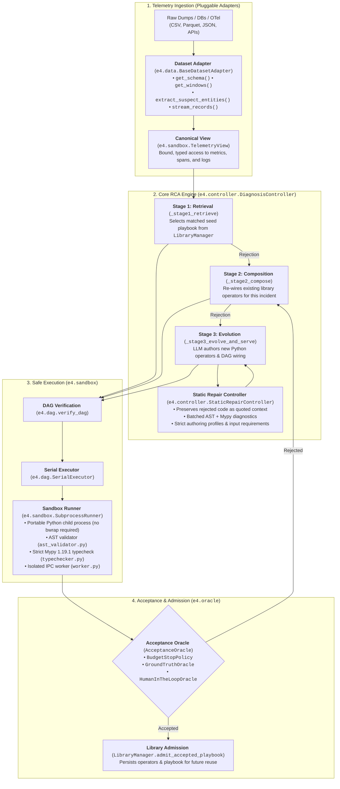
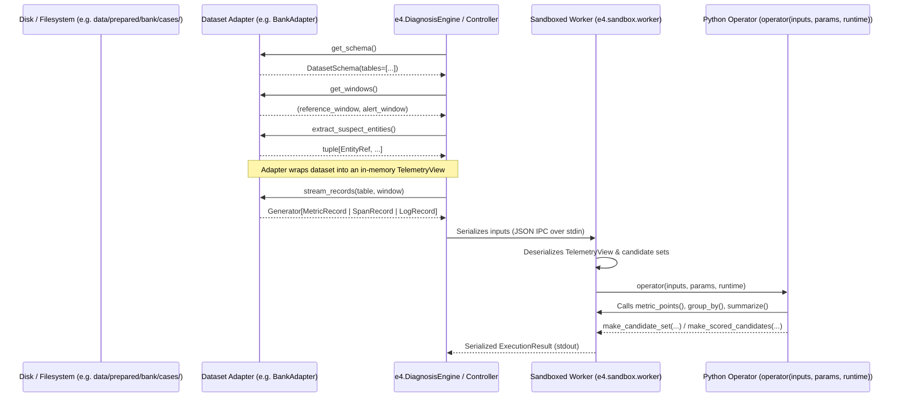
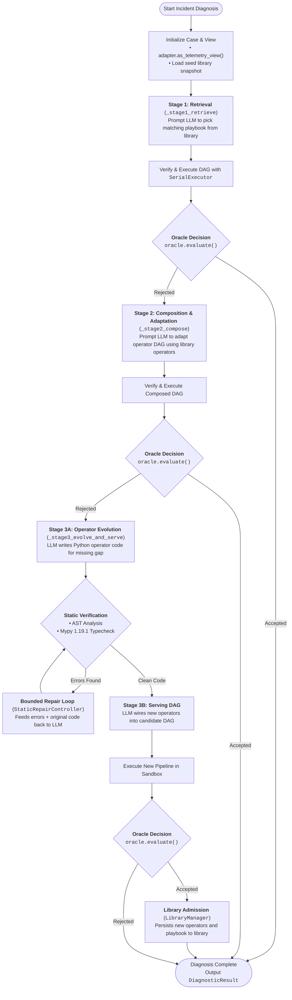

# Reading the Simplified E4 Implementation: Architecture, Data Flow & Code Review Guide

This guide is an end-to-end technical reference for reading, reviewing, and debugging the refactored **E4** codebase following the architectural simplification proposal. It explains **where input data originates**, **how dataset adapters isolate domain details**, **how the 3-stage diagnosis loop operates**, and **the exact Python modules, classes, and functions executed at every phase**.

---

## 1. Architectural Overview & Simplification Highlights

Prior to this refactoring, E4 coupled dataset parsing, Bubblewrap sandboxing, prompt generation, and a legacy DSL into multi-thousand-line monolithic modules (`e4core/m4_controller.py`, `e4infra/bank_prep.py`). The refactored system decouples these concerns into a modular, domain-agnostic, pip-installable engine:



### Key Changes from Legacy Architecture
1. **Pip-Installable, Domain-Agnostic Core (`e4/`)**:
   - Zero hardcoded references to Bank, OpenRCA, or dataset column layouts in the engine core.
   - Clean top-level API: `DiagnosisEngine` runnable in under 10 lines of Python.
2. **Standard 4-Method Dataset Adapter Protocol (`e4.data.TelemetrySource`)**:
   - Any telemetry source (metrics, spans, logs) implements 4 methods: `get_schema()`, `get_windows()`, `extract_suspect_entities()`, and `stream_records()`.
   - Built-in conformance suite: `e4.data.check_adapter_conformance()`.
   - Declarative folder loader `FolderTelemetrySource` for rapid zero-code CSV/TSV setup.
3. **Elimination of Bubblewrap Hard Dependency**:
   - Multi-tier AST security validation (`validate_source`) blocks dangerous builtins (`eval`, `exec`), system imports (`os`, `sys`, `socket`), and private attributes.
   - Strict static typechecking with Mypy 1.19.1 using dynamic typed stubs.
   - Default `SubprocessRunner` runs safely on Linux, macOS, and containerized CI without requiring unprivileged user namespaces. Bubblewrap remains an optional backend (`BubblewrapRunner`).
4. **Section 8 Evolution Failures Resolved**:
   - Eliminated contradictory prompt instructions; LLM is instructed to author full Python code (`def operator(inputs, params, runtime): ...`).
   - `StaticRepairController` preserves rejected source as quoted context in repair prompts.
   - Batched diagnostics collect AST, schema, and typecheck errors together rather than failing on the first error.
   - Strict enforcement of `authoring_profile` (`typed-operator-code-v1`), `input_requirements`, and operator naming convention `evolved.<lowercase_name>`.
5. **Pluggable Oracles**:
   - Replaced custom evaluation sockets with the typed `AcceptanceOracle` protocol (`evaluate(candidate_answer, context) -> Decision`).

---

## 2. Package & Repository Structure

```
.
├── pyproject.toml              # Build & dependency metadata, CLI script mapping
├── e4/                         # Domain-agnostic core engine package
│   ├── __init__.py             # Public symbols: DiagnosisEngine, setup, etc.
│   ├── types.py                # Canonical dataclasses & telemetry contracts
│   ├── oracle.py               # Pluggable AcceptanceOracle protocol & implementations
│   ├── registry.py             # OperatorSpec, PortSpec, ParameterSpec, OperatorRegistry
│   ├── dag.py                  # verify_dag() and SerialExecutor
│   ├── engine.py               # High-level DiagnosisEngine facade & setup()
│   ├── cli.py                  # CLI commands: 'e4 setup', 'e4 adapter-prompt'
│   ├── sandbox/                # Execution isolation & verification
│   │   ├── __init__.py
│   │   ├── ast_validator.py    # AST safety analysis (blocks os, sys, eval, etc.)
│   │   ├── views.py            # Typed runtime views (TelemetryView, CandidateSetView, etc.)
│   │   ├── typechecker.py      # Strict Mypy stub generation & checker
│   │   ├── worker.py           # Child process IPC worker executing operator code
│   │   └── runner.py           # SubprocessRunner, BubblewrapRunner, InProcessRunner
│   ├── data/                   # Dataset adapter protocols & helpers
│   │   ├── __init__.py
│   │   ├── adapter.py          # TelemetrySource, BaseDatasetAdapter, conformance checker
│   │   ├── folder.py           # Declarative FolderTelemetrySource (CSV/TSV)
│   │   └── agent_prompt.py     # Prompt generator for autonomous adapter creation
│   ├── prompts/                # LLM prompting templates & reference code examples
│   │   ├── __init__.py
│   │   ├── examples.py         # Static type-checked reference operator code
│   │   └── templates.py        # Prompts for retrieve, compose, evolve, serve, repair
│   └── controller/             # Orchestration & repair state machine
│       ├── __init__.py
│       ├── schemas.py          # LLM response JSON schema validators
│       ├── library.py          # Playbook & LibraryManager (snapshots, admission)
│       ├── repair.py           # StaticRepairController (bounded repair with context)
│       └── controller.py       # DiagnosisController (3-stage progression loop)
├── adapters/                   # Dataset adapters and starter operator libraries
│   ├── __init__.py
│   ├── bank_adapter.py         # Production Bank benchmark adapter (BaseDatasetAdapter)
│   ├── bank_library.py         # Bank starter operators & seed playbook
│   └── demo_adapter.py         # Independent OTel metric & span adapter (proof of zero coupling)
├── benchmarks/                 # Benchmark runners
│   ├── __init__.py
│   └── bank_benchmark.py       # Clean Bank benchmark harness with GroundTruthOracle
└── tests/
    └── test_e4/                # Verification test suite
        ├── __init__.py
        ├── test_adapters.py    # Conformance tests for BankAdapter & DemoServiceAdapter
        ├── test_dag_and_sandbox.py  # AST validation, Mypy checks, SubprocessRunner
        ├── test_engine.py      # 10-line engine test and setup CLI test
        └── test_vertical_slice.py   # Full 3-stage loop: retrieve -> compose -> evolve -> admit -> reuse
```

---

## 3. Data Flow: How Telemetry Enters the Engine

Telemetry ingestion is decoupled from the RCA controller through the `TelemetrySource` protocol.



### 3.1 The 4-Method Adapter Protocol ([`e4/data/adapter.py`](file:///localscratch/ssinha97/E4/e4/data/adapter.py))
Every dataset adapter inherits from [`BaseDatasetAdapter`](file:///localscratch/ssinha97/E4/e4/data/adapter.py) and implements:

| Method | Return Type | Role |
| :--- | :--- | :--- |
| `get_schema()` | [`DatasetSchema`](file:///localscratch/ssinha97/E4/e4/types.py) | Declares table names, record types (`metric`, `span`, `log`), and column definitions. |
| `get_windows()` | `tuple[Window, Window]` | Returns `(reference_window, alert_window)` with start/end epoch milliseconds. |
| `extract_suspect_entities()` | `tuple[EntityRef, ...]` | Discovers available entities (containers, services, pods) present in telemetry. |
| `stream_records(table, window)` | `Iterator[Record]` | Yields normalized [`MetricRecord`](file:///localscratch/ssinha97/E4/e4/types.py), [`SpanRecord`](file:///localscratch/ssinha97/E4/e4/types.py), or [`LogRecord`](file:///localscratch/ssinha97/E4/e4/types.py). |

### 3.2 Conformance Testing
Any adapter can be verified using [`check_adapter_conformance()`](file:///localscratch/ssinha97/E4/e4/data/adapter.py):
```python
from e4.data import check_adapter_conformance
from adapters.bank_adapter import BankAdapter

adapter = BankAdapter(case_dir="/path/to/case")
result = check_adapter_conformance(adapter)
assert result["conforms"] is True, f"Adapter failed: {result['errors']}"
```

---

## 4. End-to-End Execution Flow (3-Stage Controller Loop)

The root orchestration logic is implemented in [`DiagnosisController.run_diagnostic()`](file:///localscratch/ssinha97/E4/e4/controller/controller.py).



---

## 5. Code Review Navigation Pointers

When reviewing the code, read the files in the following order:

### 1. Types & Contracts: [`e4/types.py`](file:///localscratch/ssinha97/E4/e4/types.py)
- **What to look for**: Clean dataclasses with zero domain assumptions. Note the canonical representations for [`Window`](file:///localscratch/ssinha97/E4/e4/types.py), [`EntityRef`](file:///localscratch/ssinha97/E4/e4/types.py), [`DatasetSchema`](file:///localscratch/ssinha97/E4/e4/types.py), [`CandidateSet`](file:///localscratch/ssinha97/E4/e4/types.py), [`ScoredCandidates`](file:///localscratch/ssinha97/E4/e4/types.py), and [`RankedAnswer`](file:///localscratch/ssinha97/E4/e4/types.py).
- **Serialization**: Notice that every contract has `.as_dict()` for strict, deterministic JSON serialization across subprocess boundaries.

### 2. DAG Verification & Execution: [`e4/dag.py`](file:///localscratch/ssinha97/E4/e4/dag.py)
- **What to look for**: [`verify_dag()`](file:///localscratch/ssinha97/E4/e4/dag.py) validates port connections, verifies parameter requirements, detects dependency cycles, and accepts external inputs like `"telemetry"`.
- [`SerialExecutor`](file:///localscratch/ssinha97/E4/e4/dag.py) evaluates nodes in topological order, dispatching operator calls to a pluggable [`SandboxRunner`](file:///localscratch/ssinha97/E4/e4/sandbox/runner.py).

### 3. Sandbox Security & Execution: [`e4/sandbox/`](file:///localscratch/ssinha97/E4/e4/sandbox/)
- [`ast_validator.py`](file:///localscratch/ssinha97/E4/e4/sandbox/ast_validator.py): Inspect `validate_source()`. Blocks forbidden imports (`os`, `sys`, `socket`, `open`), `eval`, `exec`, and private dunder attributes. Permits standard typing and annotations (`Inputs`, `Params`, `Runtime`).
- [`typechecker.py`](file:///localscratch/ssinha97/E4/e4/sandbox/typechecker.py): Inspect `check_operator_types()`. Compiles operator source against a dynamically generated stub `_e4_typed_profile_api.pyi`. Uses `JSONValue` and `Scalar` rather than `Any` to satisfy Mypy's `--disallow-any-explicit`.
- [`worker.py`](file:///localscratch/ssinha97/E4/e4/sandbox/worker.py): Child process entry point. Receives JSON task over stdin, prepares runtime views, invokes `operator(inputs, params, runtime)`, and returns typed results over stdout.
- [`runner.py`](file:///localscratch/ssinha97/E4/e4/sandbox/runner.py): [`SubprocessRunner`](file:///localscratch/ssinha97/E4/e4/sandbox/runner.py) manages child process execution with timeouts and memory limits.

### 4. Controller & Repair State Machine: [`e4/controller/`](file:///localscratch/ssinha97/E4/controller/)
- [`controller.py`](file:///localscratch/ssinha97/E4/e4/controller/controller.py): Clean 3-stage progression loop in ~330 lines. Inspect `_stage1_retrieve`, `_stage2_compose`, and `_stage3_evolve_and_serve`.
- [`repair.py`](file:///localscratch/ssinha97/E4/e4/controller/repair.py): Inspect `evolve_with_repair()`. Shows how Section 8 failure modes are fixed: original failed code is preserved as quoted context in repair prompts, and AST/typecheck errors are batched together.
- [`schemas.py`](file:///localscratch/ssinha97/E4/e4/controller/schemas.py): Schema validations for operator proposals, requiring `authoring_profile: typed-operator-code-v1` and enforcing `evolved.<name>` naming conventions.

### 5. Dataset Adapters: [`adapters/`](file:///localscratch/ssinha97/E4/adapters/)
- [`bank_adapter.py`](file:///localscratch/ssinha97/E4/adapters/bank_adapter.py): Production Bank adapter implementing `BaseDatasetAdapter`. Slices container metrics, service metrics, and RPC traces.
- [`bank_library.py`](file:///localscratch/ssinha97/E4/adapters/bank_library.py): Domain starter operators (`bank.metrics.aggregate`, `bank.anomaly.scorer`, `paper.answers.weighted_consensus`) and seed playbook.
- [`demo_adapter.py`](file:///localscratch/ssinha97/E4/adapters/demo_adapter.py): Independent OTel adapter demonstrating zero core coupling.

### 6. Acceptance Oracles: [`e4/oracle.py`](file:///localscratch/ssinha97/E4/e4/oracle.py)
- Inspect [`AcceptanceOracle`](file:///localscratch/ssinha97/E4/e4/oracle.py), [`BudgetStopPolicy`](file:///localscratch/ssinha97/E4/e4/oracle.py), [`GroundTruthOracle`](file:///localscratch/ssinha97/E4/e4/oracle.py), and [`HumanInTheLoopOracle`](file:///localscratch/ssinha97/E4/e4/oracle.py).

---

## 6. How to Run and Verify

### 6.1 Running the Verification Test Suite
All new tests are located in `tests/test_e4/`:
```bash
# Run all unit and integration tests (AST, Mypy, SubprocessRunner, Adapters, Engine, Vertical Slice)
.venv/bin/python -m unittest discover -s tests/test_e4 -v
```

### 6.2 Programmatic Usage (10 Lines of Python)
```python
from adapters.bank_adapter import BankAdapter
from adapters.bank_library import build_bank_operator_registry, build_seed_playbook
from e4 import DiagnosisEngine, GroundTruthOracle

adapter = BankAdapter("/localscratch/ssinha97/E4/data/prepared/bank/public/cases/bank-20210304T1800-utc8")
engine = DiagnosisEngine(
    registry=build_bank_operator_registry(),
    seed_playbooks=[build_seed_playbook()],
    oracle=GroundTruthOracle(ground_truth_entities=["cartservice"]),
)
result = engine.diagnose(adapter)
print(f"Accepted: {result.accepted}, Top Cause: {result.top_entity_id}")
```

### 6.3 Using the CLI
```bash
# Initialize a new dataset configuration
e4 setup --data-dir ./my_telemetry --output-dir ./my_project

# Print AI prompt to generate a custom adapter for your dataset
e4 adapter-prompt --schema ./my_telemetry/schema.json
```
