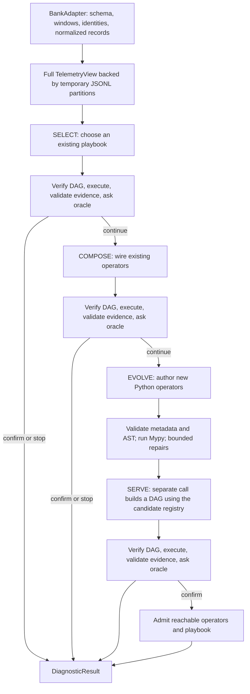

# Code review guide

This guide follows the current simplified implementation in `e4/`. Start with the reading route below, then trace one starter playbook through the controller. The completed Bank experiment used an explicit Bank starter library; the new package defaults and bootstrap workflow are unscored.

The design decisions and review history are in [SIMPLIFICATION_PROPOSAL.md](SIMPLIFICATION_PROPOSAL.md), especially Sections 16–17. Historical scripts elsewhere in the repository are not the entry point for the current experiment. Results from the earlier kernel implementation are a separate variant.

## 1. Read these files first

| Order | Source and symbols | What to check |
| --- | --- | --- |
| 1 | [engine.py](../e4/engine.py): `DiagnosisEngine.__init__`, `diagnose` | How the model, library, oracle and runner enter the system. This facade delegates to the controller. |
| 2 | [controller.py](../e4/controller/controller.py): `DiagnosisController.run_diagnostic` | The entire three-stage loop is in this method, under SELECT, COMPOSE and EVOLVE/SERVE comments. There are no separate `_stage1_retrieve` or `_stage3_evolve_and_serve` methods. |
| 3 | [bank_library.py](../adapters/bank_library.py): `get_bank_seed_playbook`, `get_bank_contrast_playbook`, `build_bank_registry` | The actual starting pipelines and six available starter operators. Read their implementations next. |
| 4 | [types.py](../e4/types.py): `EntityRef`, `Evidence`, `ScoredCandidates`, `RankedAnswer` | The values that move between operators, the controller and evaluator. Discovery alone is not a supported diagnosis. |
| 5 | [dag.py](../e4/dag.py): `verify_dag`, `SerialExecutor.execute_verified` | How a JSON pipeline becomes a verified execution order; where trusted functions and authored source take different execution paths. |
| 6 | [templates.py](../e4/prompts/templates.py) and [repair.py](../e4/controller/repair.py) | Exactly what the model sees and what happens when a proposal fails validation. |

Then follow the adapter and worker boundaries in Sections 4–6 below. The tests in Section 8 provide small, readable examples of each path.

## 2. Trace one incident



Read `run_diagnostic()` from top to bottom with these questions:

1. **What information enters?** The adapter supplies schema, reference/alert windows and observed suspect identities. `public_digest` contains case ID, windows, table names and suspect identities. It is not a summary of metric values or trace relationships.
2. **What does SELECT change?** It chooses a stored playbook and can bind node parameters. The controller copies the DAG, verifies it, executes it, and passes the output through `_to_ranked_answer()` before evaluation.
3. **What does COMPOSE change?** It constructs a new DAG from registered operators. An accepted composition becomes a reusable playbook.
4. **What does EVOLVE change?** It authors new operator source. After static checks, the operators enter a cloned candidate registry. A separate SERVE call composes a diagnosis DAG against that registry.
5. **What persists?** Only confirmed additions enter the active library. Stage 3 prunes nodes that do not contribute to the return node and admits reachable proposed operators. Unverified proposals do not mutate the active library.

There are three diagnosis attempts, not necessarily three model calls. EVOLVE and SERVE are separate calls; repairs also consume calls and tokens. A failed later attempt can return the previous supported answer with status `unverified`; that is not a confirmed success.

## 3. Understand the explicit Bank benchmark starter library

All six operators are registered in [bank_library.py](../adapters/bank_library.py). Their implementations are ordinary trusted Python functions.

| Operator | Implementation | Actual behavior |
| --- | --- | --- |
| `bank.metrics.aggregate` | `bank_metric_aggregate_impl` | Scan a complete metric table/window; compute means by component and metric. |
| `bank.metrics.contrast` | `bank_metrics_contrast_impl` | Pair reference/alert aggregates. Score a service by its largest absolute relative metric shift, with denominator floor `1e-4`; retain evidence for up to three shifts. |
| `bank.traces.aggregate` | `bank_traces_aggregate_impl` | Scan a complete trace table/window; compute mean duration per executing component. |
| `bank.traces.latency_contrast` | `bank_traces_latency_contrast_impl` | Score positive mean-duration increases against reference, with denominator floor `1.0`. |
| `bank.anomaly.scorer` | `bank_anomaly_scorer_impl` | Score each entity by its largest alert aggregate value. This is an absolute-value heuristic, not a calibrated anomaly test. |
| `paper.answers.weighted_consensus` | `weighted_consensus_impl` | Normalize each scorer by its maximum, take a maximum within each analysis family, then sum weighted family contributions while preserving evidence. |

The two starter playbooks are:

```text
bank.starter.metric_consensus
  alert metric aggregate → absolute-value scorer → weighted consensus

bank.starter.metric_contrast
  reference metric aggregate ─┐
                              ├→ metric contrast → weighted consensus
  alert metric aggregate ─────┘
```

Trace operators are registered and available for composition, but neither initial playbook uses them. Read `CANONICAL_FAMILY_ALIASES` and the family maximum in consensus to see why repeating the same analysis should not add independent votes.

The `paper.answers` name does not establish full paper fidelity. This simplified starter has six operators and two playbooks; the wider historical starter inventory and statistical semantics are not all present here.

## 4. Follow the data, without labels

Start at [adapter.py](../e4/data/adapter.py). `TelemetrySource` defines four methods: `get_schema()`, `get_windows()`, `extract_suspect_entities()`, and `stream_records(table_name, window)`. Inheriting `BaseDatasetAdapter` provides convenience methods; a source can also satisfy the protocol directly.

Then read [bank_adapter.py](../adapters/bank_adapter.py):

- `_init_schema()` advertises available source files. A present empty file and an absent file are different cases.
- `_timestamp_ms()` uses the public source-date unit declarations. Window boundaries use epoch milliseconds and half-open intervals.
- `stream_records()` normalizes metric, span and log rows into core contracts. Native app KPI columns are `rr`, `sr`, `cnt`, `mrt`; their physical units remain unknown where source policy does not establish them.
- `extract_suspect_entities()` discovers rankable components. Opaque app transaction codes are `app_kpi` identities, not component root causes.
- Trace `success` is unavailable in Bank and remains `None`. The legacy core field `duration_ms` does not establish a known physical unit for this source; inspect the schema and adapter details before interpreting absolute durations. Relative comparisons retain the source values.

The controller uses `as_full_telemetry_view()`, not the bounded `as_telemetry_view()` convenience path. Follow [record_store.py](../e4/data/record_store.py): `from_adapter()` writes normalized JSONL partitions by table and window, `descriptor` supplies worker handoff metadata, and `iter_records()` streams partitions. The parent owns temporary storage; worker views reopen it without taking cleanup ownership.

This avoids embedding millions of rows in each worker task. It does not put raw telemetry or evaluator labels in the model prompt.

## 5. Distinguish an evolved operator from its serving DAG

An evolved operator is **new Python analysis code**, with entry point:

```python
def operator(inputs, params, runtime):
    ...
```

Its source is stored in `OperatorSpec.source`. It is not required to contain a DAG of existing high-level operators. The serving DAG is a separate JSON object whose nodes can call existing and newly authored operators. Read [registry.py](../e4/registry.py) for `OperatorSpec`, `PortSpec` and `ParameterSpec`.

The available data-acquisition and result-construction API lives in [views.py](../e4/sandbox/views.py):

| API | Review focus |
| --- | --- |
| `metric_points`, `span_records`, `log_records` | Typed rows and explicit query coverage; raw queries are bounded. |
| `aggregate_records` | Full-window aggregation over normalized records, grouping fields, supported statistics and coverage. |
| `group_by`, `summarize`, `top_k` | Local operations on already retrieved values; they do not recover rows omitted by a bounded query. |
| `make_evidence`, `make_aggregate*`, `make_scored_candidate*` | Native result construction, support, contributors and eligibility. |
| `aggregate_view`, `scored_views`, `candidate_views` | Typed read interfaces over operator outputs. |

For an actual source example, read `METRIC_ANOMALY_EXAMPLE` in [examples.py](../e4/prompts/examples.py), then `typed_api_reference()`. Compare the reference against the runtime helpers and the generated Mypy stub in [typechecker.py](../e4/sandbox/typechecker.py). A helper name alone is not enough: inspect its argument types, nullable fields and returned coverage.

In [dag.py](../e4/dag.py), verification checks references, ports, parameter values, bindings, schema requirements and acyclicity. `SerialExecutor` executes in topological order. Parameters can resolve declared bindings such as `runtime.dag_depth`. Trusted `implementation` functions run directly in the coordinator; source operators use the selected runner.

## 6. Read validation and execution as separate boundaries

Follow these files in order:

1. [schemas.py](../e4/controller/schemas.py): proposal metadata, `gap_record`, one-to-three operators, supported profile and output types, identity/source duplication checks. Exact duplicate detection does not prove semantic novelty.
2. [repair.py](../e4/controller/repair.py): `validate_and_typecheck()` and `attempt_repairs()`. Structural validation precedes per-proposal AST/Mypy checks. Default repair allowance is two additional model calls. Repair context preserves rejected source, proposal metadata, public schema and typed API reference.
3. [ast_validator.py](../e4/sandbox/ast_validator.py): permitted imports, builtins and attribute access.
4. [typechecker.py](../e4/sandbox/typechecker.py): stub generation, annotation handling and `check_operator_types()`.
5. [runner.py](../e4/sandbox/runner.py) and [worker.py](../e4/sandbox/worker.py): serialization, typed worker inputs, execution, resource limits and result reconstruction.

The current campaign uses `SubprocessRunner` with 120 seconds and 512 MiB per authored operator. Its process limits and source restrictions are not an OS-level security boundary. Optional `BubblewrapRunner` currently rejects file-backed telemetry transport; it cannot be substituted into this campaign without further implementation. `InProcessRunner` is used for controlled tests.

Static checks cannot guarantee that data-dependent runtime errors, unsupported operations or resource exhaustion never occur. Review error handling as well as happy paths.

## 7. Check evidence, evaluator and model context

Read `_to_ranked_answer()` near the start of [controller.py](../e4/controller/controller.py). A final candidate must correspond to an observed suspect and have contributing evidence with positive support and ranking eligibility. An unscored `CandidateSet` is rejected.

This is the boundary behind the latest fix: `EntityRefView` and `EntityRef` have different dataclass types. Matching now uses role plus canonical component identifier, and native outputs contain native identities. The observed display identifier is preserved. Compare this with `_core_entity()` in the Bank library and [test_entity_identity_boundary.py](../tests/test_e4/test_entity_identity_boundary.py); that test runs real starter DAGs through final validation.

Next read [oracle.py](../e4/oracle.py):

- `GroundTruthOracle` checks whether a labeled component appears in the top three, and can confirm, continue or stop unverified.
- `BudgetStopPolicy` stops without certifying correctness.
- `HumanInTheLoopOracle` delegates the decision to a callback.

The benchmark loads labels on the evaluator side. Model prompts receive public telemetry context and attempt history, including oracle feedback; no ground-truth component is inserted into those prompts.

Read the actual formatters in [templates.py](../e4/prompts/templates.py) to assess context limitations. SELECT receives playbook names/descriptions, not their full DAGs. COMPOSE receives history, signatures and the public digest. EVOLVE additionally receives the dataset schema, typed API and source example. SERVE receives proposed operator documents, candidate-registry signatures, the digest, prior diagnosis history and the public schema. Failed SELECT/COMPOSE history retains the attempted DAG, and rejected supported answers include bounded candidate scores and evidence summaries. This is recorded execution context, not a complete transcript of every intermediate analysis.

## 8. Review tests and the experiment harness

| Source | What it exercises |
| --- | --- |
| [test_vertical_slice.py](../tests/test_e4/test_vertical_slice.py) | Full staged flow, repair, admission and reuse with controlled model responses. |
| [test_entity_identity_boundary.py](../tests/test_e4/test_entity_identity_boundary.py) | Actual metric/trace starter output through identity/evidence validation, plus negative cases. |
| [test_section17_bank.py](../tests/test_e4/test_section17_bank.py) | Native Bank schemas, timestamp units, complete scans and file-backed transport. |
| [test_section17_contracts.py](../tests/test_e4/test_section17_contracts.py) | Typed helper contracts, grouping aliases, proposal/repair context and evidence guards. |
| [test_review_repairs.py](../tests/test_e4/test_review_repairs.py) | Earlier review regressions, including admission reachability and public APIs. |
| [test_three_seed_runner.py](../tests/test_e4/test_three_seed_runner.py) | Checkpoints, backend failures, usage accounting, aggregation and frozen client settings. |

The maintained suite passed **75 tests** after the entity fix:

```bash
.venv/bin/python -m unittest discover -s tests/test_e4 -v
```

For a small initial review, run only the boundary and staged-flow tests:

```bash
.venv/bin/python -m unittest \
  tests.test_e4.test_entity_identity_boundary \
  tests.test_e4.test_vertical_slice -v
```

The current experiment enters through [run_bank_three_seed.py](../scripts/run_bank_three_seed.py), which invokes [bank_benchmark.py](../benchmarks/bank_benchmark.py). Review `run_chain()`, `run_campaign()`, `aggregate_run_roots()`, `run_benchmark()` and `LocalLlamaClient.complete()`.

Each seed has two independent five-case chains with pristine starter libraries, assigned to local and Wingtip endpoints. Learned additions persist only within a chain. Seeds 42/43/44 repeat the same ten incidents: thirty trajectories are not thirty independent incidents. Confirmed cumulative stage successes measure the escalation trend; all model calls, including repairs and EVOLVE/SERVE, contribute to cost.

Section 17 of the proposal records the immutable source hashes and artifact locations. The first campaign is explicitly invalidated because of the identity bug; the clean restart writes `campaign_v2/`. Engineering canaries and invalid-run costs remain separate from corrected scored results. The live experiment imports its frozen runtime, so editing this guide does not change its code.

## 9. Adapting this to another domain

Use [demo_adapter.py](../adapters/demo_adapter.py) and [folder.py](../e4/data/folder.py) as alternative data-source examples. A new domain needs its own adapter/schema, rankable identity policy, useful starter library and acceptance policy. Those choices determine which analyses are possible; merely renaming the Bank starter is insufficient.

A useful final review exercise is to follow one component identity and one evidence item from `stream_records()` through aggregation, scoring, worker serialization, `_to_ranked_answer()` and oracle evaluation. Then follow a rejected operator through repair and check that a failed proposal never reaches the active library.


For the new initialization/evolution template review checkpoint, see [INITIALIZATION_PROMPT_REVIEW.md](INITIALIZATION_PROMPT_REVIEW.md). The packaged templates and offline exporter are reviewed before any starter generation. Initialization and evolution share [authoring.py](../e4/prompts/authoring.py); the worker supports the existing import allowlist and module-level helpers. No new accuracy result is implied by these changes.


For the revised package defaults, start at [onboarding.py](../e4/onboarding.py), then read [the six paper-family implementations and gaps](PAPER_DEFAULT_LIBRARY.md). `DiagnosisEngine` delays automatic default loading until it sees the adapter schema; explicitly supplied libraries are preserved. `LibraryManager` persists the mode and restores native functions, while schema-specific signatures/playbooks are used in prompts. The complete revised stage order is in the short [prompt review guide](INITIALIZATION_PROMPT_REVIEW.md).
