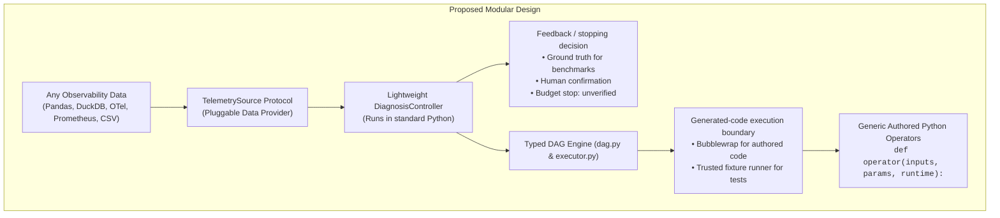

# Architecture Simplification Proposal: Making E4 Portable, Extensible, and Reusable

**Date:** November 2026

**Status:** Reviewed proposal; implementation pending

**Target:** Separate a small, typed Root-Cause Analysis (RCA) engine from dataset-specific analysis and benchmark tooling so external developers can adopt it on their telemetry.

**Review update, November 4:** Prefer removal and a deliberate cutover over wrapping every existing path in new abstractions. Support the current Python authoring mode in the new engine; preserve historical implementations through Git and frozen artifacts. Sections 7–9 give the revised migration order, fixes for the observed evolution failures, and acceptance criteria. The API examples below describe the proposed design, not an already implemented package.

## 0. Handoff: Project Context and Starting State

This section is for an implementation agent with no conversation history. **Your assignment is to implement the simplification in this document and the authoring-interface fixes in Section 8.** The user will bring the completed work back for review before deciding on further experiments. This document is a plan; do not assume its proposed `e4` package or APIs already exist.

### 0.1 What we are trying to reproduce

We are reimplementing the E4 paper at [arXiv:2610.08622](https://arxiv.org/pdf/2610.08622). The scientific objective is to test whether the **harness and reusable library** improve diagnosis as it escalates, using the same model for the method and baseline. Paper results are the reference trends to investigate; a missing trend calls for diagnosis, not changing labels, selecting favorable retries, or weakening starter analyses until the desired numbers appear.

The intended behavior is:

1. **Retrieve:** select a stored playbook, instantiate its parameters from the case/runtime and execute its typed DAG.
2. **Adapt:** compose or modify a diagnosis DAG using existing registered operators, informed by earlier failed analyses and public evidence.
3. **Evolve:** author genuinely new Python operator implementations to address a structured analysis gap. Validate them, then make a **separate SERVE call** that composes a diagnosis DAG using the extended library. This serving step is composition again; operator authoring itself must not simultaneously diagnose/rank the incident.

The outer playbook is always a typed DAG. An evolved operator is an atomic Python function, `operator(inputs, params, runtime)`, using typed inputs and generic data-access/aggregation helpers. It is **not required to be a composition of existing high-level operators or a fixed analysis-kernel catalog**. Filtering, grouping, aggregation and quantiles are data APIs, not a prescribed menu of diagnostic algorithms. Keep runtime bindings such as `runtime.dag_depth` explicit and typed.

For the Bank benchmark, success means a ground-truth component appears in the **top three within three diagnosis submissions**. Three submissions do not mean three model requests: EVOLVE and SERVE are separate, and bounded static repairs can add requests. The current benchmark has two shared Stage 3 static repairs and up to three proposed new operators. Preserve experimental settings when comparing results; make general engine limits explicit configuration rather than Bank-specific branches.

The current baseline is **T2 (Terminus 2)**. Reuse recorded baseline results; no new baseline/model experiment is requested for this refactor. The paper's original artifact and exact evaluation subset were not supplied, so the project uses public resources and reconstructed starter libraries with gaps documented. Bank lacks the paper's internal client/session data; do not invent those fields or assume its rich-client playbooks transfer unchanged.

### 0.2 Current results: keep the variants separate

The dataset is **OpenRCA Bank**, using ten frozen real incidents. These are reused exploratory cases, not an independent holdout. Early synthetic engineering checks, including historical perfect scores, are not dataset accuracy results. Telecom code remains in the repository but is not the current evaluation target.

| Variant | Seeds / incidents | Retrieval | Through adaptation | Through evolution |
| --- | --- | ---: | ---: | ---: |
| Historical kernel-constrained implementation, commit `7de48fe` | Seeds 42 and 43, same ten incidents; means | 30% | 55% | 70% |
| Current Python authoring implementation | Seed42 only, ten incidents | 20% | 50% | 50% |

Historical final accuracy was 8/10 for seed42 and 6/10 for seed43. Recorded T2 accuracy is 4/10 for each seed. The new Python run is **not** a two-seed comparison; its seed43 run has not started. Statistical significance has not been established.

In the new run, all five cases reaching evolution failed proposal validation before new operators executed. Fifteen EVOLVE responses produced four JSON failures, five name-format failures and six incomplete-requirement failures as their first reported errors. Additional static/API problems are described in Section 8. This is not evidence that free Python analysis is intrinsically worse than kernels.

The new run used 38 calls, 654,559 prompt tokens and 127,453 completion tokens. Its separate engineering canary succeeded at retrieval and did not exercise evolution; do not substitute that success for the full evaluation's first-case failure. Even identical first-call payloads with seed42 produced different outcomes between those runs; the backend cause is unproven, so do not assume fixed-seed inference is perfectly deterministic.

Read [current results](BANK_CURRENT_RESULTS.md), [the evolution diagnosis](NON_KERNEL_EVOLUTION_DIAGNOSIS_20261104.md), and [the code reading guide](CODE_REVIEW_GUIDE.md) for navigation. The guide is a review draft of the current large implementation, not the desired final layout; verify native filenames and types against the adapter/configuration and tests rather than treating illustrative diagrams as the schema contract.

### 0.3 Repository baseline and how to compare the refactor

- Working branch when this handoff was prepared: `paper-operator-code`; coordinator workspace: `/localscratch/ssinha97/E4`.
- Historical measured kernel baseline: `7de48fe175459d28007be8ff0bf6c0838313df17`.
- **Simplification baseline:** the checkpoint commit that first adds this document. It contains the current Python implementation, tests and these handoff/diagnosis documents. The final handoff message provides its hash. It intentionally preserves the known authoring bugs; the Section 8 fixes and architectural migration are not yet implemented.
- Work on a separate simplification branch from that checkpoint. Preserve unrelated untracked files and local artifacts; do not use a broad workspace cleanup to remove legacy code. Remove selected maintained paths deliberately as part of the cutover.

Locate the checkpoint and compare the completed work with it:

```bash
git log --diff-filter=A --format='%H %s' -- docs/SIMPLIFICATION_PROPOSAL.md
git diff <checkpoint>..HEAD --stat
git diff <checkpoint>..HEAD -- e4 src adapters benchmarks e4core scripts config tests docs
```

The current implementation uses `e4core/`, not the proposed `e4/` layout. Main reference points:

| Area | Current entry points |
| --- | --- |
| Stage orchestration and prompts | `e4core/m4_controller.py`: `run_diagnostic`, `_stage_prompt`, `_static_repair_prompt` |
| Operator spec and registration | `e4core/m4_generated.py`: `typed_operator_code_contract_schema`, `validate_generated_spec`, `register_generated_specs` |
| Typed data API and transport | `e4core/operator_code_api.py`; helpers and source policy in `e4core/sandbox_worker.py` |
| Compilation and isolation | `e4core/m4_typecheck.py`, `e4core/sandbox.py` |
| DAG, values and runtime | `e4core/dag.py`, `executor.py`, `contracts.py`, `runtime.py`, `registry.py` |
| Bank analyses and persistence | `e4core/paper_starter.py`, `bank_adapter.py`, `m4_capabilities.py`, `m4_library.py` |
| Benchmark-only machinery | `scripts/run_m4_bank.py`, `run_paper_starter_audit.py`, `freeze_paper_starter.py`, `e4core/m5_evaluation.py` |

The current mode is `typed-operator-code-v1`, selected by `config/paper_starter_authoring.json` and persisted in library policy. Legacy absent-profile snapshots dispatch to IR V2 today; this compatibility is something to retire from the new normal engine, not a model to copy. `run_diagnostic` preserves the input library and writes its resulting library under `run_dir/library`; reuse that output, not the original input snapshot.

### 0.4 Validation and available environment

The current code has engineering coverage, but do not claim a fully clean current release suite:

- DGX focused validation: **58 tests, 56 passed and two skipped**, including actual isolated Python authoring, serving, admission and reuse on another case.
- Canary CLI entrypoint tests: **3/3 passed** locally and on DGX. These mock the model/worker boundary and are not accuracy evidence.
- Earlier broad 601-test runs found code and environment failures. The identified compatibility/annotation/test-fixture failures were fixed and checked in focused runs; a subsequent all-tests, zero-skip release result was not established.
- A 40-prompt initial-context tokenizer check passed on the pinned server with the 8,192-token generation reserve. It is not a proof that every future retained-library/repair prompt fits. Keep actual context checks and report any skipped isolation checks.

Use the project `.venv` and `requirements-m3.lock`. The coordinator environment is Python 3.10.9; the DGX environment is Python 3.10.12. System Python is not the pinned project runtime. Focused commands for the existing reference implementation are:

```bash
.venv/bin/python -m unittest \
  tests.test_operator_code_runtime \
  tests.test_typed_operator_code_integration \
  tests.test_paper_starter_policy \
  tests.test_paper_starter_audit \
  tests.test_typed_authoring -v
.venv/bin/python -m unittest tests.test_paper_operator_code_canary -v
```

Local Bubblewrap is unavailable, so actual isolated execution was checked on `ssinha97@dgxstation.cc.gatech.edu`. Its existing project is `/raid/ssinha97/E4`; the evaluated Python candidate is:

```text
/raid/ssinha97/E4/artifacts/operator_code_fix_20261103/execution_candidate_20261104
```

Within that candidate, the official freeze is `artifacts/operator_code_canary/final_freezes/20261104T054005Z-cd185022/freeze_manifest.json`; the verified combined result is `artifacts/operator_code_evaluation/seed42/audits/20261104T060301Z-bc016eb2/combined_bank10_result.json`. Raw model journals and datasets are local artifacts, not source dependencies. Inspect structured outputs/compiler errors and usage metadata; do not read or publish model reasoning or credentials.

GPU inference previously used the coordinator's P100/V100 pair and `ssinha97@wingtip-gpu2.cc.gatech.edu` (RTX8000); DGX ran controllers/operators on CPU because its GPUs were inaccessible. Do not reset/reboot shared GPUs. Previously started services/tunnels may have expired: verify current availability rather than relying on old process IDs or ports.

The fixed model is local Gemma, pinned in `config/model_manifest.json` and `config/gemma_m3_inference.json`: 32,768 context tokens, 8,192 generation tokens, reasoning enabled with budget 2,048, seed42, temperature 1.0, top-p 0.95 and top-k 64. No paid API access is assumed. Model changes are outside the simplification task; future users can supply a model client through the proposed small interface.

### 0.5 Scope, working preferences and return handoff

- Implement the structure and interface fixes first; keep historical experiments intact. No additional full Bank evaluation or seed43 run is requested during this handoff. Phase 6 is follow-up work after the user returns for review; it is not authorization to start another long experiment automatically. Neutral transport checks and small engineering tests can verify the new path.
- Keep all LLM-authored operator code typed and isolated. Preserve separate EVOLVE/SERVE calls, actionable bounded repairs, source attribution, missingness/coverage, and explicit confirmation for active-library admission. Do not simplify by reverting evolution to kernels or existing-operator composition.
- Use Luna for implementation writes when the available delegation tools support it; the supervising agent reviews architecture and changes. Use actual exposed model names rather than assuming a particular Luna version is available.
- Keep `README.md` limited to how to run the code and current results; architecture belongs in docs. Label synthetic/scripted tests as engineering checks.
- Never stage `agent_plan/` and do not add it to `.gitignore`. Keep raw experiments, recovered conversations, models, credentials and local build directories out of the commit.
- The user requests commits without an assistant co-author. Do not push unless requested. Preserve the checkpoint for comparison rather than amending it away.

When finished, return the branch/commit, a brief old-to-new file map, deleted paths, run commands and validation results with skips/limitations. Demonstrate that a second adapter needs no core changes, identify any remaining benchmark/domain coupling, and distinguish structural completion from unrun real-model/accuracy checks. The user will then bring the work back to the original agent for review and a decision on remaining actions.

---

## 1. Executive Summary: Why Is E4 So Hard to Borrow?

E4 contains powerful, state-of-the-art ideas:
1. **A typed DAG execution engine** with formal contracts between observability analysis nodes.
2. **Autonomous Python operator authoring** where an LLM writes genuine Python data-analysis code with strict Mypy type-checking and AST security gates.
3. **A structured 3-stage diagnostic progression**: Retrieve known playbook $\to$ Adapt/compose existing operators $\to$ Synthesize novel code.

However, **external developers cannot easily borrow this code today**. The reason is that the core diagnostic engine is deeply entangled with an **academic benchmark harness**:
* **The "Double-Sandbox Inception"**: A host supervisor (`_run_outer`) launches Bubblewrap to run the controller (`_run_inner`), which launches a *second* Bubblewrap container to run every generated Python operator.
* **The 5-Tier Data Adaptation Web**: Raw data must pass through offline clipping, ground-truth decoupling, multi-gigabyte table slicing, and cryptographic SHA-256 manifest pinning before `load_bank_case()` will even load it.
* **Hardcoded Benchmark Schemas**: Table names (`bank/metric_container.csv`), column names (`cmdb_id`, `kpi_name`), and specific timezones (`Asia/Shanghai`) are hardcoded across controller prompts, capability verifiers, and worker helpers.
* **The Feedback Coupling Problem**: The normal experiment entry point uses IPC to grade against private labels. The controller's `_call_feedback()` already accepts an ordinary callable, so IPC is not intrinsically required by the loop. The reusable API still needs explicit decisions for continuing, confirming, or stopping with an unverified diagnosis when no answer key exists.

This proposal outlines a path to **decouple the general-purpose RCA engine from the benchmark test harness**, reducing adoption complexity from weeks of reverse-engineering to a clean, 10-line Python interface.

---

## 2. The 43,000-Line Reality: Where Did All the Code Go?

The November 4 working tree contains **43,309 implementation lines** across `e4core`, `e4infra`, `e4baseline`, and `scripts`, plus **19,363 test lines**. These counts exclude vendored dependencies and artifact copies. For a framework whose core task is to run a three-stage diagnostic loop and execute a DAG of Python operators, the implementation is too difficult to inspect.

An audit of the codebase explains why:

| Subsystem / File Group | Approximate Lines | What It Actually Is |
| :--- | :---: | :--- |
| **Monolithic Controller** ([`e4core/m4_controller.py`](../e4core/m4_controller.py)) | **4,288** | Prompt templates, repair loops, schema checks, stage progression and artifact handling. |
| **Hardcoded Bank Starter Catalog** ([`e4core/paper_starter.py`](../e4core/paper_starter.py)) | **2,119** | Paper starter analyses, Bank adaptations and playbook construction. |
| **Sandbox Worker & Helpers** ([`e4core/sandbox_worker.py`](../e4core/sandbox_worker.py)) | **1,740** | Source policy, typed views, row decoding and query implementations. |
| **Legacy IR Museum** (`m4_operator_ir.py`, `_worker.py`, `_v2_worker.py`, `m4_composite.py`) | **~4,500** | **Dead weight**: Old DSL compilers and kernel engines kept solely to replay past commits (`7de48fe`). |
| **Academic Audit & Anti-Tamper Harness** (`m5_manifest.py`, `bank_prep.py`, `audit_*.py`, etc.) | **~15,000** | Cryptographic SHA-256 fingerprinting, attempt ledgers, view inventories, and non-contamination proof scripts. |
| **Domain-Specific Bank Pipeline** (`bank_adapter.py`, `bank_ops.py`, `run_bank_*.py`) | **~5,000** | Parsers and clippers tailored exclusively to the OpenRCA Bank benchmark. |
| **Total implementation Python** | **43,309** | Excludes tests and vendored/artifact copies. |

Subsystem estimates overlap and are not an additive accounting. The important issue is coupling: even `dag.py` contains checks for named Bank operators, while supposedly generic records include Bank-specific fields. These need extraction, not merely new directory names.

### The 4 Drivers of Bloat

1. **Academic Forensic Auditing (~15,000 lines)**:
   Benchmark bookkeeping includes source freezes, attempt ledgers, restricted views and input manifests. These belong in an optional benchmark runner. The ordinary engine should retain useful provenance—operator versions, data revision, model settings, attempts, evidence and cost—without requiring the entire experimental artifact tree.
2. **The "Museum" of Dead Experiments (~5,000 lines)**:
   Instead of pruning superseded prototypes, the repository retains the entire legacy kernel DSL infrastructure (`typed-operator-ir-v1` and `v2`) alongside the current Python authoring mode (`typed-operator-code-v1`), forcing every controller check to maintain backwards-compatibility baggage.
3. **Procedural Monoliths Instead of Clean Objects (~5,000 lines)**:
   `m4_controller.py` contains a single ~900-line diagnostic function surrounded by procedural helper functions that manually format prompt dictionaries and catch errors across deep nested `if/elif/else` ladders.
4. **Hardcoded Dataset Logic (~5,000 lines)**:
   The OpenRCA Bank benchmark is not an external plug-in—it is hardcoded directly into the core engine with custom parsers, CMDB column mappers, and metric permutation math.

### An Aspirational Core Budget (~2,000–2,500 Lines)

Aim for a small core that can be read end to end. **2,000–2,500 lines is a design target, not a guaranteed estimate**; it excludes domain analyses, optional benchmark tooling, examples and tests. Do not meet the target by hiding essential behavior in dependencies or undocumented callbacks.

```
e4/
├── dag/           # DAG verification, acyclicity, topological executor (~600 lines)
├── sandbox/       # AST security validator, Mypy stub typechecker, bwrap runner (~500 lines)
├── controller/    # Clean 3-stage loop: Select -> Compose -> Evolve/Serve (~400 lines)
├── data/          # TelemetrySource protocol and basic CSV/Parquet adapters (~300 lines)
└── prompts/       # Structured Jinja2/string prompt templates (~200 lines)
─────────────────────────────────────────────────────────────────────────────
Target: a few thousand readable core lines; measure the whole maintained system too.
```

---

## 3. Before vs. After Architecture

### Current Architecture (Over-Engineered Benchmark Harness)

```mermaid
flowchart TD
    subgraph CURRENT ["Current Coupled Design"]
        R["Raw Multi-Day OpenRCA CSVs"] --> PREP["Offline Preparation (scripts/prepare_bank.py)"]
        PREP --> MANIFEST["config/bank_input_manifest.json (SHA-256 Pinning)"]
        MANIFEST --> CLIP["Clipped Cases on Disk"]
        CLIP --> OUTER["_run_outer() Host Supervisor"]
        OUTER --> SOCKET["UNIX Domain Socket (Evaluator with Private Labels)"]
        OUTER --> BWRAP1["Layer 1: Bubblewrap Namespace"]
        BWRAP1 --> INNER["_run_inner() (run_m4_bank.py --inside)"]
        INNER --> CONTROLLER["4,288-line m4_controller.py"]
        CONTROLLER -->|IPC Socket Query| SOCKET
        CONTROLLER --> EXECUTOR["SerialExecutor"]
        EXECUTOR --> BWRAP2["Layer 2: Bubblewrap Container (per Python Operator)"]
        BWRAP2 --> WORKER["sandbox_worker.py (Hardcoded Bank tables)"]
    end
```


### Proposed Architecture (Modular, Pluggable RCA Engine)


---

## 4. Four Core Simplification Pillars

### Pillar 1: Eliminate the Double-Sandbox (Run Controller Directly)

#### The Problem:
`scripts/run_m4_bank.py` uses a self-re-executing pattern where `_run_outer` launches `_run_inner` inside Bubblewrap just to prevent the controller from reading ground-truth labels. This creates massive operational overhead:
* Requires root/unprivileged user namespaces on the host machine.
* Breaks standard debuggers (PDB, VS Code debugger cannot easily attach across nested `bwrap` forks).
* Requires inter-process communication (IPC) sockets and proxy objects (`BinaryFeedbackProxy`) to communicate across the boundary.

#### The Solution:
Run the controller as a **standard, unprivileged Python application**.
1. **Ordinary engine use**: Run the trusted controller directly and keep isolation at the generated-code execution boundary, currently implemented in [`e4core/sandbox.py`](../e4core/sandbox.py).
2. **Benchmark use**: Keep any required outer isolation and private evaluator IPC in a separate benchmark entry point. It must not be mandatory for normal use or imported by the core.
3. **Local development**: A subprocess or in-process runner is suitable for trusted test fixtures. It is not an equivalent security boundary and must never silently replace isolation for live generated code.

---

### Pillar 2: Replace the 5-Tier Data Adaptation Web with a `TelemetrySource` Protocol

#### The Problem:
An adopter cannot pass in their own metrics without writing complex CSV clippers and generating cryptographic SHA-256 manifests.

#### The Solution:
Define a clean, Pythonic protocol for telemetry data:

```python
from typing import Iterator, Protocol
from e4.types import DatasetSchema, EntityRef, TelemetryRecord, Window

class TelemetrySource(Protocol):
    """Abstract interface for querying incident observability data."""

    def get_schema(self) -> DatasetSchema: ...
    def get_windows(self) -> tuple[Window, Window]: ...
    def extract_suspect_entities(self) -> list[EntityRef]: ...
    def stream_records(self, table_name: str, window: Window) -> Iterator[TelemetryRecord]: ...
```

`TelemetryRecord` is a union of canonical typed metric, span and log records, not `dict[str, Any]`. `DatasetSchema` declares typed columns, units, nullability, source availability and entity roles. The shared query layer supplies bounded typed queries, aggregation, coverage and pagination over this interface. Adapters implement the four methods once; they do not implement a second, competing query API.

Preserve unknown units and missing values explicitly. Reference/alert windows use UTC half-open intervals; adjacency is not a universal domain requirement. Additional domain fields need a declared schema that feeds both static checking and runtime access. Native column names and timezone conversion remain inside the adapter/mapping.

#### Why this is better:
* **Provider options**:
  * `FolderTelemetrySource`: Reads loose CSV/Parquet files from any directory without requiring SHA-256 manifests.
  * `DataFrameTelemetrySource`: Accepts in-memory Pandas/Polars DataFrames directly.
  * `DuckDBTelemetrySource`: SQL-backed telemetry querying.
  Start with Bank and a simple folder/CSV provider. DataFrame, Parquet and database backends are optional extensions, not prerequisites for the first core implementation. Folder-based loading still needs explicit column mappings, units and incident windows; it must not guess these silently.
* **Manifests become optional**: Cryptographic hash checking is kept as an optional opt-in flag (`--verify-manifest`) for official benchmark scoring, not a mandatory runtime requirement.

---

### Pillar 3: Pluggable `AcceptanceOracle` (Decoupling from Benchmark Labels)

#### The Problem:
The benchmark entry point in [`e4core/m4_controller.py`](../e4core/m4_controller.py) uses private-label feedback. `_call_feedback()` already accepts a callable; the missing abstraction is the meaning of its result outside benchmark scoring.

#### The Solution:
Abstract acceptance into an `AcceptanceOracle` strategy:

```python
class AcceptanceOracle(Protocol):
    def evaluate(self, answer: RankedAnswer, context: DiagnosticContext) -> Decision:
        """Return confirm, revise, or stop_unverified, with a reason."""
        ...
```

Use a small typed callback/protocol, without an oracle class hierarchy:
1. **`GroundTruthOracle`** (Benchmark mode): Compares top-3 candidates against hidden ground truth labels (retaining current benchmark capability).
2. **Budget/evidence stopping policy** (Unlabelled mode): Advances while budget and supported analyses remain, then returns an unverified diagnosis. An anomaly score or normalized consensus score is not a calibrated probability of a correct root cause.
3. **`HumanInTheLoopOracle`** (Interactive mode): Accepts explicit analyst feedback through a caller-supplied function or CLI. A UI or notification integration is optional and outside the core.

Stopping and confirming are separate. A high score alone must not mark the diagnosis confirmed or automatically admit generated operators into the active shared library. An unverified candidate can be saved for review. Results should distinguish confirmed, unverified, and exhausted outcomes. Any future calibrated confidence policy needs its own validation rather than an arbitrary default threshold.

---

### Pillar 4: Modularize the 4,288-Line Controller

#### The Problem:
[`e4core/m4_controller.py`](../e4core/m4_controller.py) currently handles prompt templating, LLM API calls, error parsing, repair retry loops, DAG typecheck calls, library snapshots and artifact saving in one 4,288-line file.

#### The Solution:
Refactor into single-responsibility modules:
* `e4/core/controller.py`: Pure stage progression orchestration (~300 lines).
* `e4/prompts/`: Jinja2 or formatted prompt templates for `select`, `compose`, `evolve`, and `serve`.
* `e4/repair/`: Isolated static repair loop for handling Mypy type-checking failures.
* `e4/library/`: Clean snapshot manager for admitting accepted playbooks and tracking invocation lineage.

These are responsibility boundaries, not a requirement to create a package or class for every helper. Keep the entire stage progression readable in one small module. Support one current Python operator format; avoid permanent compatibility branches for IR V1/V2 and stored composite formats. Retain old results and implementations through archived commits/artifacts, not through the new engine's normal import path.

Use one authoritative authoring contract to derive the JSON schema, prompt API documentation, type-checking stubs and runtime helper declarations. Prompts may add phase instructions, but must not independently restate conflicting contracts.

---

## 5. How Simple E4 Could Look for an External Adopter

The target is a short entry point after configuring an adapter, incident windows, model client and starter library. This example is a proposed API, not a claim that arbitrary raw files can already be diagnosed without adaptation:

```python
from e4 import DiagnosisEngine, FolderTelemetrySource, BudgetStopPolicy
from pathlib import Path

# 1. Use explicit mappings, units and windows for this dataset.
telemetry = FolderTelemetrySource(Path("my_incident_data/"), mapping="mapping.json")

# 2. Configure the engine with an LLM and a stopping criterion
engine = DiagnosisEngine(
    model=model_client,  # Configured local or remote client.
    stopping=BudgetStopPolicy(max_attempts=3),
    library=Path("playbooks/seed_library")
)

# 3. Run the diagnosis
result = engine.diagnose(telemetry)

print(f"Status: {result.status} (Last stage: {result.stage})")
print(f"Root Cause Suspects: {result.top_candidates}")
print(f"Generated Evidence: {result.evidence}")
```

---

## 6. The Dataset Adaptation Kit & AI-Assisted Porting

Every observability ecosystem (Kubernetes microservices, OpenTelemetry, Train-Ticket, AWS CloudWatch, custom enterprise logs) has unique table layouts, timestamps, and entity definitions. **Needing adaptation is normal and expected.**

The problem in current E4 is **not that adaptation exists—it is that adaptation is smeared across 15 different files**:
* Timezone math and CSV clippers in `e4infra/bank_prep.py`.
* File hash manifests in `scripts/prepare_bank.py` and `config/bank_input_manifest.json`.
* Table names and CMDB column lookups in `e4core/bank_adapter.py`.
* Query endpoints in `e4core/sandbox_worker.py`.
* Prompt summaries in `e4core/m4_controller.py`.

The goal of the **Dataset Adaptation Kit** is **strict containment**. A simple dataset should need one adapter file implementing four methods, plus explicit mappings/configuration. Domain-specific starter operators, playbooks and evidence rules belong alongside it and are supplied explicitly. The four methods adapt data; they do not create diagnostic knowledge for an arbitrary domain. Do not force a complex domain into a giant single file merely to meet a file-count target.

### 6.1 What Stays Untouched vs. What Gets Adapted

| Component | Status for New Datasets | Why |
| :--- | :--- | :--- |
| **Typed DAG Engine** (`dag.py`, `executor.py`) | **100% Untouched** | Completely domain-agnostic graph executor. |
| **Sandbox Isolation** (`sandbox.py`) | **100% Untouched** | Safe Linux process isolation with CPU/memory limits. |
| **Security AST Validator** (`sandbox_worker.py`) | **100% Untouched** | Prohibits `os`, `sys`, socket calls regardless of dataset. |
| **Dynamic Mypy Typechecker** (`m4_typecheck.py`) | **100% Untouched** | Enforces static Python type signatures universally. |
| **Multi-Stage Controller Loop** (`m4_controller.py`) | **100% Untouched** | Coordinates LLM stage progression generically. |
| **Single Adapter File** (`adapters/<dataset>.py`) | **User Implemented (or Agent Generated)** | Maps raw local files into the 4 standard placeholder functions. |

This table describes the target after extraction. Current `dag.py`, executor contracts and worker/typechecker code still contain paper/Bank-specific logic; they cannot be called fully domain-agnostic today. A new adapter must eventually require no changes to engine, prompt templates, sandbox worker or typechecker.

---

### 6.2 The Adapter Template with Placeholder Functions

An adopter only needs to create `adapters/<dataset>_adapter.py` by implementing these 4 placeholder functions:

```python
"""Template for adapting any new incident dataset to E4.

Fill in the 4 placeholder functions below, or use the provided AI prompt
to have your coding agent implement them from sample files.
"""

from typing import Iterator
from pathlib import Path
from e4.types import DatasetSchema, EntityRef, TelemetryRecord, Window


class BaseDatasetAdapter:
    def __init__(self, incident_dir: Path):
        self.incident_dir = incident_dir

    # -------------------------------------------------------------------------
    # PLACEHOLDER 1: Discover Table Schema & Available Metrics
    # -------------------------------------------------------------------------
    def get_schema(self) -> DatasetSchema:
        """Declare tables, typed fields, units, nullability and entity roles.

        This informs the LLM prompt which tables exist so it can author queries.
        """
        raise NotImplementedError("TODO: Return DatasetSchema for your files")

    # -------------------------------------------------------------------------
    # PLACEHOLDER 2: Extract Normal Baseline & Incident Windows
    # -------------------------------------------------------------------------
    def get_windows(self) -> tuple[Window, Window]:
        """Return (reference_window, alert_window) as UTC epoch millisecond intervals.

        reference_window: The normal pre-incident period (baseline).
        alert_window: The period during which the fault or alert occurred.
        """
        raise NotImplementedError("TODO: Parse incident timestamps into (reference, alert) Windows")

    # -------------------------------------------------------------------------
    # PLACEHOLDER 3: Discover Suspect Entities (Components to Rank)
    # -------------------------------------------------------------------------
    def extract_suspect_entities(self) -> list[EntityRef]:
        """Return distinct typed entity candidates using exact source identities.

        Example: [EntityRef("service", "order-service")]
        """
        raise NotImplementedError("TODO: Extract list of unique components/services from data")

    # -------------------------------------------------------------------------
    # PLACEHOLDER 4: Stream Normalized Metric / Span / Log Records
    # -------------------------------------------------------------------------
    def stream_records(self, table_name: str, window: Window) -> Iterator[TelemetryRecord]:
        """Stream canonical MetricRecord, SpanRecord or LogRecord values.

        Preserve source attribution, UTC timestamps, explicit units and missingness.
        """
        raise NotImplementedError("TODO: Stream rows from table_name filtered by window")
```

---

### 6.3 The "Point Your Agent to Solve It" Prompt

Instead of manually writing the adapter, an adopter can simply copy-paste this prompt into their AI coding assistant (Cursor, Antigravity, Claude, ChatGPT, etc.) alongside sample data:

````markdown
### AI Prompt: Generate E4 Dataset Adapter

You are an expert systems engineer. I want to adapt the E4 Root-Cause Analysis framework to my observability dataset.

E4 requires a single adapter file implementing `BaseDatasetAdapter` with 4 placeholder functions:
1. `get_schema()`: Declares tables, typed fields, units, nullability, availability and entity roles.
2. `get_windows()`: Extracts normal baseline (`reference`) and incident (`alert`) time intervals.
3. `extract_suspect_entities()`: Discovers unique services/components to rank.
4. `stream_records(table_name, window)`: Streams canonical typed metric/span/log records.

Here is a sample of my telemetry data:
---
[PASTE 5-10 ROWS OF YOUR METRIC CSV/PARQUET/LOG HEADERS AND ALERT METADATA HERE]
---

Please implement `adapters/my_custom_adapter.py` by filling in all 4 placeholder functions:
- Handle timestamp parsing into UTC epoch milliseconds.
- Extract the service/component names as `(role, identifier)`.
- Use the shared E4 types; do not redeclare them or return `dict[str, Any]`.
- Require explicit timestamp units/timezone and identity mappings when not declared by the source; preserve unknown units and missing values rather than guessing.
- Preserve source references and distinguish unavailable tables from available empty tables.
- Efficiently stream rows within the requested window without loading entire multi-gigabyte files into memory.
- Keep the code self-contained and clean with type annotations.
- Include adapter conformance checks for field types, windows, identities, nulls and source coverage. These checks establish adapter correctness, not RCA accuracy.
````

This should make simple mappings quick to implement. There is no universal 15-minute guarantee: ambiguous units, identities and missing fields require domain decisions. Success means the adapter and explicit domain library work without changes to core E4 code.

---

## 7. Proposed Phased Migration Plan

Build one readable path through the current method, then cut over. Do not first wrap the entire legacy controller and carry every old mode into a second framework.


| Phase | Deliverable | Completion gate |
| --- | --- | --- |
| **0. Preserve the reference** | Record commits/source archives, environment pins, data references and measured results for historical variants. | Old results remain attributable without importing old interpreters into the new engine. Do not overwrite an experimental trajectory. |
| **1. Shared typed contracts** | Canonical records, dataset schema, operator spec, runtime values, model interface and feedback/stopping decision. One authoring contract drives documentation and validation. | Valid examples pass the actual compiler; invalid fields fail before execution. No Bank table names, native columns or timezone assumptions in the generic contracts. |
| **2. Complete vertical slice** | A small controller implementing retrieve, adapt, EVOLVE, validate, separate SERVE, execute and feedback. One bounded repair routine; isolated authored-code execution. | A scripted engineering test traverses all stages, admits confirmed operators/playbook and reuses the output library on another case. The frozen input library stays unchanged. This is a correctness test, not an accuracy result. |
| **3. Bank port** | Bank adapter, mappings, starter operators/playbooks and evidence rules supplied explicitly to the engine. | Ported analyses and supplied DAGs produce equivalent evidence/rankings on fixed fixtures. Do not weaken starter analyses or change thresholds to manufacture gains. |
| **4. Portability proof** | A second independently shaped adapter and a short getting-started example. | No changes to core controller, prompts, worker or typechecker. Test different column names, entity roles, units and missingness. Start with one simple additional provider, not every backend. |
| **5. Cutover and removal** | Normal API runs without benchmark setup. Optional benchmark runner owns private labels, IPC, outer isolation, source freezes and result reconciliation. | Remove superseded IR/composite paths and their compatibility-only tests from the maintained engine. No permanent old/new runtime dispatcher. Retain useful correctness and isolation tests. |
| **6. Real-model verification** | Fresh source-bound run using the corrected authoring interface. | First demonstrate actual model-authored source passing compilation and executing in a serving DAG. Only then run the fixed Bank evaluation with all failures/costs retained. |

Implement the authoring fixes in Section 8 within this small path, rather than adding another profile or retry subsystem to the 4,288-line controller. Existing code remains a reference during migration; the objective is a deliberate replacement and deletion of obsolete paths.

Keep the ordinary run record small: model/configuration, data revision, operator/source versions, stage outcomes, compiler diagnostics, evidence, usage and cost. Benchmark-only freeze and contamination checks can remain stricter without becoming ordinary engine dependencies.

---

## 8. Immediate Fixes for the Observed Evolution Failures

These are diagnosed problems and planned fixes, not completed implementation changes. See [the detailed diagnosis](NON_KERNEL_EVOLUTION_DIAGNOSIS_20261104.md) for source references and saved evidence.

### 8.1 What the current run establishes

The completed non-kernel Bank run used seed42 on ten frozen incidents: **2/10 retrieval, 5/10 after adaptation, 5/10 after evolution**. All five evolution cases stopped before Stage 3 serving or execution of newly authored operators.

| First reported blocker across 15 EVOLVE responses | Count |
| --- | ---: |
| Invalid JSON | 4 |
| Invalid operator name | 5 |
| Missing input requirement fields | 6 |

The 11 parseable responses contained 22 proposed functions; 21 had valid Python syntax. An offline diagnostic with hypothetical metadata-only repairs and unchanged source found that **3/22 passed spec/type checking**. The remaining functions had type/API, import, AST-policy or syntax errors. These were static checks only, not executed or rescored diagnoses.

The earlier kernel mode supplied its input ABI/requirements through host code. The new Python mode additionally asks the model to author metadata, imports, annotations and JSON-escaped source. This run therefore does not isolate whether a kernel catalog helps diagnostic reasoning. It exposes authoring-interface failures first.

### 8.2 Fixes and verification gates

| Problem | Required change | Verification before another evaluation |
| --- | --- | --- |
| **Conflicting phase instructions** | Remove the actual EVOLVE instruction “No generated source is written in this stage.” Use explicit phase templates: EVOLVE creates Python operators and a gap record; SERVE composes the registered operators into a DAG. | Test complete rendered system/user/repair prompts for every phase, not just their final paragraph. No leaked legacy IR or contradictory no-source instructions in code authoring. |
| **Ambiguous required fields** | Make `authoring_profile` and `input_requirements` explicitly required for the current mode. Publish complete per-port shapes, including empty fields for typed non-telemetry inputs where applicable. Correct `group_by_by_table` wording to match the chosen grouping contract. | The same contract generates schema and validator expectations. Test valid declarations for Telemetry, Aggregate, CandidateSet and ScoredCandidates; report exact missing/unexpected fields. |
| **Name-format friction** | Publish the exact accepted name format and a concrete example, such as `evolved.metric_change`. Keep naming independent of diagnostic content. | Check that contract examples pass actual name validation; reject invalid names with the expected format in the diagnostic. Do not silently rename executable references. |
| **Malformed JSON containing Python** | Test schema-constrained JSON output on the pinned server, including its reasoning configuration. If verified, constrain the envelope, names and required metadata while keeping source analysis model-authored. | A neutral transport test preserves multiline source/escaping, permits arbitrary supported analysis bodies and records truncation separately. Record this protocol change in the next experiment freeze. A schema-valid envelope does not prove valid Python. |
| **Source discarded during repair** | Keep the rejected source available as quoted artifact data. Preserve usable code while requesting the necessary corrections, and revalidate the complete result. | A metadata-only repair sees the original source. Actual rendered-token checks cover the repair payload; do not silently truncate bodies or expand the retry budget to hide failures. |
| **One error consumes each repair** | Report independent actionable errors across the proposal bundle together where prerequisites permit, including operator/field/line identifiers. Avoid burying the primary issue under cascaded `Any` errors. | Saved malformed-name/missing-field proposals expose both defects in the same feedback cycle. Invalid signatures still block execution; diagnostics do not weaken validation. |
| **Unclear typed API usage** | Include small, compiled interface examples for `.rows`, coverage, nullable values, quantiles, allowed imports and annotated nested helpers. Correct nonexistent API pointers and remove redundant legacy-profile documentation. | Examples use the exact shared API and pass the actual strict checker. Negative tests reject invented fields, unsupported statistics and runtime use of annotation-only aliases. Examples must not supply domain diagnostic algorithms. |
| **Validation tests stop short of the real path** | Verify actual model request routing, isolated execution, output-library admission and subsequent reuse. | Run a real sandbox test; a local skip is not a pass. Assert parsed audit JSON, inspect the output library, and select the actual admitted playbook rather than a Stage 3 placeholder name. |

Keep strict typing, declared data capabilities, source policy, isolation and evidence validation. Their role is to catch invalid code before execution; improve the authoring contract and feedback rather than suppressing those errors.

### 8.3 Order of work

1. Define the shared authoring/data contracts and phase prompts; resolve required fields, grouping semantics, naming and API pointers together.
2. Implement source-preserving bounded repair and actionable compiler feedback in the new vertical slice.
3. Verify JSON-constrained transport and typed API examples using neutral fixtures and the actual pinned server where needed. Keep model, analysis and acceptance changes separately attributable.
4. Use saved failures as offline regression inputs. Preserve their originals; hypothetical repairs are diagnostic evidence, not new benchmark outcomes.
5. Run a fresh real-model canary that **actually reaches evolution and serving**. An incident accepted at retrieval only verifies startup/retrieval. If using a deliberate stage-specific engineering test, label it separately from the end-to-end benchmark.
6. Resume the fixed evaluation only after those gates. Record stage accuracy, proposal validation/execution rates, admission/reuse, all calls and costs. Keep old and new variants/seeds separate; do not replace failed benchmark trajectories with successful canaries.

---

## 9. Acceptance Criteria for the Simplified Design

- **Readable control flow:** the complete three-stage progression is understandable in one small module. Extract responsibilities without multiplying framework classes or adding general plugin machinery that the current use cases do not need.
- **Actual removal:** obsolete interpreters, compatibility dispatch, migration utilities and duplicated definitions are removed from the normal maintained path, rather than hidden behind a new facade.
- **Portable imports:** the generic engine has no Bank/Telecom table names, native columns, fixed incident-ID patterns, dataset timezones or imports from dataset/benchmark packages. Domain-specific parameter/evidence validation belongs to the supplied operator/domain definitions.
- **Typed throughout:** normalized records, query results, parameters, operator outputs and feedback decisions have explicit types. One contract supplies compiler stubs, runtime declarations and prompt schemas; source/API examples are checked against it.
- **Explicit domain knowledge:** adapters, starter analyses/playbooks and evidence rules are separate inputs. Adding a domain does not require changing core prompts, compiler or worker code.
- **Honest outcomes:** stopping without external confirmation returns an unverified result. A normalized score is not treated as a correctness probability or an automatic admission decision.
- **Small operational footprint:** ordinary diagnosis does not require SSH hosts, benchmark artifacts, private labels, a Docker baseline image or historical experiment manifests. Generated-code isolation remains explicit.
- **Useful provenance:** retain data/operator versions, model settings, evidence, decisions, errors and cost. Put optional forensic freezes and private-label reconciliation in the benchmark runner.
- **Measured portability and size:** report core, domain, benchmark and test size separately. The core line target and short entry-point example are goals, not substitutes for successful second-adapter conformance and manual code review.

Implementation and experiment work remain pending. This document records the agreed direction and proposed verification gates; it does not claim that restructuring or the authoring fixes have already been completed.
