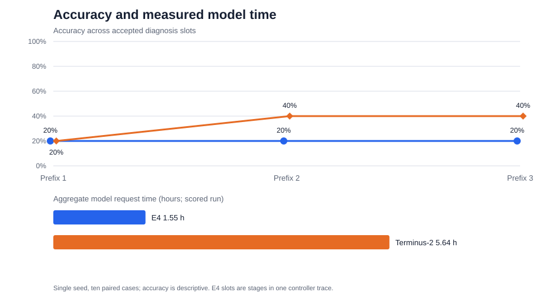

# M5 and initial M6 results

## Finding

On this single seed-42 pass over ten fixed OpenRCA Bank incidents, E4's Accuracy@3 did not increase across its three stage-slot prefixes (2/10, 2/10, 2/10). Terminus-2 reached 2/10, 4/10, and 4/10 across its submission prefixes. This does not reproduce a rising E4 accuracy trend. These are descriptive counts from one small sample and do not support an inferential comparison.

E4 used fewer measured tokens and model/wall-clock seconds, while its final prefix accuracy was lower: 2/10 versus 4/10. Including bootstrap, E4 used 13.3% of Terminus-2's prompt tokens, 27.6% of its generated tokens, 28.1% of its model seconds, and 37.3% of its wall seconds. This comparison does not establish an efficiency gain at equal accuracy. E4's schema-only bootstrap adds 146.6 model seconds and 155.1 wall seconds separately; including it, E4 used 1.59 model hours and 2.21 wall hours. Amortized over ten cases, that bootstrap adds 14.7 model seconds and 15.5 wall seconds per case. These are observed run costs under a shared local model server.

## Accuracy and paired cases

Accuracy@3 here means at least one accepted diagnosis within the first 1, 2, or 3 diagnosis slots; a case contributes at most once at each prefix. E4 and Terminus-2 were evaluated on the same ten incidents. E4's slots are its retrieval, composition, and synthesis stages from the same controller trace, not three separate runs; Terminus-2's slots are successive diagnosis submissions.

| System | Attempt 1 | Through attempt 2 | Through attempt 3 |
|---|---:|---:|---:|
| E4 | 2/10 (20%) | 2/10 (20%) | 2/10 (20%) |
| Terminus-2 | 2/10 (20%) | 4/10 (40%) | 4/10 (40%) |

Per-case cumulative prefix outcomes, token counts, costs, and counts of submitted diagnoses, failed slots, and unrun slots are in [paired_cases.csv](results/paired_cases.csv). The full ordered slot records remain in each raw case JSON. Aggregate `submissions` fields in the comparison JSON count attempted stage slots, including failed slots, and should not be interpreted as actual submitted diagnoses.

## Resource accounting

| Measure | E4 scored | E4 + bootstrap | E4 + bootstrap per case | Terminus-2 scored |
|---|---:|---:|---:|---:|
| Prompt tokens | 630,417 | 639,643 | 63,964 | 4,816,553 |
| Generated tokens | 133,049 | 137,222 | 13,722 | 497,665 |
| Model calls | 50 | 51 | 5.1 | 321 |
| Model seconds | 5,570.4 | 5,717.1 | 571.7 | 20,309.6 |
| Wall seconds | 7,817.5 | 7,972.6 | 797.3 | 21,373.5 |

CPU execution, physical reads, and full physical I/O are unknown (`null`), not zero. The shared model server load took 6.04 seconds and is recorded separately. E4's logical-scan and returned-byte counters cover only instrumented public-query paths and are partial; zeros mean those counters recorded no bytes for that path, not that no data was processed. Terminus-2 has no comparable query byte counters. We therefore make no I/O or cache-efficiency claim.

The paired jobs ran serially. Wall time includes task setup, data access, program execution and validation, along with model requests; server reuse and prompt caching affect the observed costs. Model seconds measure request time. Neither quantity isolates system-independent latency.

## M5 development and bootstrap

The two fixed development cases produced E4 Accuracy@3 across attempt prefixes of 50%, 50%, 50% and Terminus-2 of 50%, 50%, 50%. This run was used for readiness and budget measurement; it is separate from the ten scored cases.

The fresh schema-only E4 bootstrap completed with one model call, 9226 prompt tokens, 4173 generated tokens, 146.6 model seconds, and 155.1 wall seconds. It admitted zero generated operators and zero generated playbooks; the initial library retained ten built-in operators and four verified seed playbooks. Terminus-2 has no analogous bootstrap phase, so its bootstrap cost is zero.

Frozen manifest SHA-256: `a4bb8489736cd9b01b72128b974db7e975334c6dd06f407b7e0f252bf96a68c7`. Frozen source archive SHA-256: `14b00ba6c7f028d91ede80abe8b01bb255de626e9ba2a372b1532be5319040ae`.

## Failure and admission audit

Across the ten E4 traces, stage 1 accepted 2 cases and rejected 8. Stage 2 had 3 diagnostic rejections and 5 static-validation failures. Stage 3 had 6 runtime execution failures, 1 truncated generation, and 1 static-validation failure; two cases had already been accepted at stage 1. E4 had 13 actual submitted diagnoses, 13 failed slots, and 4 not-run slots. Six generated operator definitions were attempted and zero were admitted; zero generated playbooks were admitted. The retained library therefore contains the initial built-ins and seed playbooks only.

The six stage 3 runtime failures include four serialized operator inputs reaching the 2 MiB input limit and two generated code errors involving missing `isinstance` or `math` names. The serving guidance documents the 2 MiB cap; a discoverability gap remains in the generated-spec contract's builtins list. Stage 2 failures included `inputs=array` static validation with exhausted repair. These are observed execution and admission outcomes; zero admissions does not mean zero synthesis attempts.

Terminus-2 submitted 14 diagnoses and left 16 slots not run. One case (1/10) explicitly ended with `CallBudgetExhausted` at the 73,728 generated-token ceiling and did not reach a third submission. Five other nonaccepted cases ended with complete job status but no error or termination reason in the recorded result; they are unresolved trajectory outcomes and are not attributed to turn-budget exhaustion.

A separate interrupted first invocation (`bankm6i1`) is excluded from the completed comparison totals. It started one Terminus-2 HTTP request that received no response; the server log shows at least 590 generated tokens, but exact usage is unknown. The request and server logs remain under `artifacts/m3/model_runs/bankm6i1/`. This is retained as execution overhead rather than counted as a scored case or included in the completed run's resource totals.

No diagnosis was manually selected. The evaluator's exact component-identity rule determined acceptance. The frozen source archive is `artifacts/m5/experiments/bank_m6_initial_20261017_02/frozen_source.tar.gz`; the first scored pass is preserved as measured, including its errors and missing trajectory detail.

## Reproduction and limits

The frozen scored manifest SHA-256 is `a4bb8489736cd9b01b72128b974db7e975334c6dd06f407b7e0f252bf96a68c7`. Raw scored outputs remain under `artifacts/m3/model_runs/bankm6i2/m6_comparison/`; development and bootstrap artifacts are preserved under their respective run directories. This report reads only aggregate results, attempt metadata, and stage status counts; it does not publish evaluator truth labels or predicted component identities.

This is a local comparison, not a direct reproduction of the paper's setup: it used Gemma 4 31B Q4_0 rather than Gemini, reconstructed four Bank seed playbooks and ten trusted built-ins, and had no original E4 implementation or original incident subset to run. Harbor Terminus-2 was pinned to upstream revision `26106c6d9c66848a1440faf5724d336affac52aa`; the paper's exact baseline revision is not established. These constraints, the single seed and ten-case sample, and incomplete CPU/I/O instrumentation mean the observed trend should not be treated as a faithful refutation or reproduction of a paper result.

The full source test suite had passed 270 tests with 5 environment skips before the frozen run. Local Terminus integration and shared-server reuse also limit broader conclusions.
